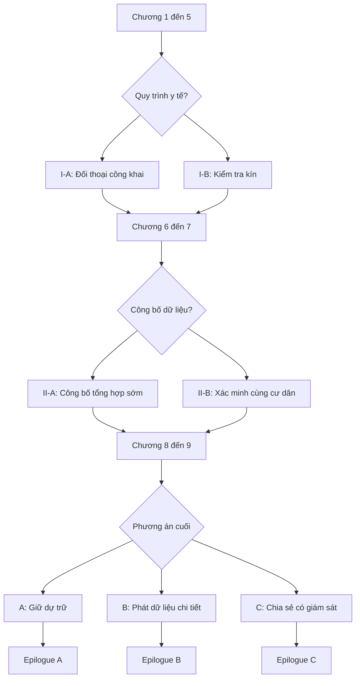
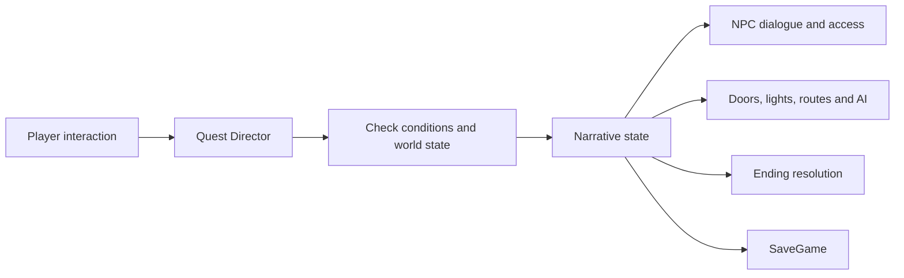

# GAME DESIGN BLUEPRINT (BẢN ĐỀ XUẤT)
## Những Người Không Có Chỗ Dưới Bầu Trời

**Phiên bản tài liệu:** 0.1 — Thiết kế chuyển thể từ bản truyện phân nhánh 10 chương  
**Thể loại:** Single-player, 3D third-person action-adventure, điều tra và quyết định có hậu quả  
**Nền tảng ưu tiên:** Windows PC (tay cầm + bàn phím/chuột)  
**Engine ưu tiên:** Unreal Engine 5, Blueprint-first; Unity 6 URP là phương án dự phòng nếu đội mạnh C#  
**Mục tiêu sản phẩm đầu tiên:** Vertical slice 45–60 phút, không triển khai đồng thời cả 10 chương.

> **Tuyên ngôn thiết kế:** Người chơi không được trao quyền "cứu tất cả" bằng chiến đấu. Họ có sức mạnh đủ để đối phó một mối đe dọa cục bộ, nhưng việc thay đổi hệ thống phân phối tài nguyên đòi hỏi bằng chứng, sự đồng thuận và trách nhiệm trước các cộng đồng chịu ảnh hưởng.

---

## 1. Chuyển thể đúng bản sắc truyện

### 1.1. Điều giữ nguyên

- **Mai:** nhân viên kiểm toán tin vào hệ thống Giá trị Công dân (GTC); thay đổi từ người bảo vệ quy trình thành người học cách lắng nghe hậu quả ngoài đời.
- **An:** đứa trẻ sửa ô, trung tâm cảm xúc; An không phải "vật phẩm hộ tống" hoặc phần thưởng hoàn thành nhiệm vụ.
- **Hạ:** người mẹ và tiếng nói cộng đồng, có mục tiêu độc lập; được quyền phản bác Mai.
- **Linh:** kỹ sư giúp Mai phân tích hiện trạng, đối diện với rủi ro ổn định kỹ thuật.
- **Thu:** bác sĩ làm việc giữa quy trình và nhu cầu của bệnh nhân.
- **Khang:** người góp phần thiết kế hệ thống ban đầu với động cơ phức tạp.
- **Vinh:** người bảo vệ ổn định xã hội, không được xây thành phản diện "ác vì ác".
- **Lưu Quang:** mái vòm, Lõi Sáng, Vành Đệm, Rìa Mưa, mạng lưới điện và hệ thống điểm công dân.
- **Ba quyết định lớn của truyện:** (I) công khai hoặc kiểm tra kín một quyết định y tế; (II) công bố dữ liệu tổng hợp sớm hoặc kiểm chứng tiếp; (III) giữ dự trữ, công bố dữ liệu chi tiết để gây sức ép, hoặc đàm phán phương án chia sẻ có giám sát.

### 1.2. Những điều cần sáng tạo thêm để trở thành game hành động

Mai là kiểm toán viên, không phải lính chiến. Vì vậy, **vũ khí/khả năng phải có nguồn gốc hợp lý**: bộ thiết bị kiểm tra công trình cấp khẩn do tổ bảo trì mái vòm sử dụng, về sau Linh hỗ trợ chỉnh sửa để vô hiệu hóa máy tự hành hoặc vượt qua hành lang đang nguy hiểm. Không thêm sức mạnh siêu nhiên vào đời sống nhân vật chỉ để hợp thức hóa đánh nhau.

Các trận chiến chủ yếu đối đầu **drone an ninh, máy sửa chữa mất kiểm soát, hệ thống khóa tự động và những cơ chế bảo vệ nguy hiểm**. Xung đột với cư dân hoặc nhân viên hành chính ưu tiên đối thoại, tránh trở thành game đánh bại những người bất đồng quan điểm chính trị.

### 1.3. Ba trụ cột gameplay

1. **Action:** đánh cận chiến có nhịp, né/đỡ, vô hiệu hóa hệ thống tự động và đánh boss theo cơ chế.
2. **Investigation & traversal:** quét sai lệch dữ liệu, tìm bằng chứng, vượt chướng ngại, kích hoạt thiết bị và kết nối tuyến cứu hộ.
3. **Consequence:** lựa chọn có người được lợi, người bị thiệt, dữ liệu hoặc lòng tin thay đổi; quyết định từ nhiệm vụ trước xuất hiện trong NPC, thế giới và đoạn kết.

Mọi nhiệm vụ chính nên kết hợp **ít nhất hai** trong ba trụ cột; tránh chia cứng "chương đánh nhau" và "chương xem hội thoại".

---

## 2. Vòng lặp gameplay

**Vòng lặp ngắn (3–7 phút):** thăm dò môi trường → phát hiện sự cố / nguy hiểm → né và vô hiệu hóa máy canh hoặc giải puzzle → nhặt chứng cứ hoặc mở tuyến đường → đánh giá hậu quả tức thời → trở lại NPC/hub.

**Vòng lặp nhiệm vụ (20–40 phút):** nhận yêu cầu từ một người có nhu cầu thực → lựa chọn tiếp cận (điều tra công khai/kín, tuyến thâm nhập, xử lý máy móc) → combat/traversal → bằng chứng mới làm phức tạp vấn đề → quyết định/đối thoại → NPC và môi trường phản hồi.

**Vòng lặp toàn game:** trải nghiệm chênh lệch giữa ba khu → kiểm chứng niềm tin của Mai → xây dựng hoặc đánh mất lòng tin → bão đến, các hệ thống phải phân bổ lại điện → lựa chọn cuối nhận hậu quả của những việc đã làm.

### 2.1. Cơ chế điều khiển tối thiểu

- WASD: di chuyển; Shift: chạy; Space: nhảy; Ctrl: cúi; chuột: nhìn/khóa mục tiêu.
- Chuột trái: tấn công cơ bản; chuột phải: đỡ/chống đỡ đúng nhịp; Alt: né.
- Q: xung điện làm gián đoạn máy; E: tương tác; F: quét GTC và cơ cấu kỹ thuật; R: thiết bị móc kéo ở vị trí đã thiết kế.
- Gamepad: bố trí tương ứng và cho phép chỉnh nút về sau.

**Lưu ý:** ưu tiên 1 vũ khí chính và 2 kỹ năng rõ cơ chế ở prototype; không mở rộng ngay thành cây kỹ năng 40 nút.

### 2.2. Bộ thiết bị của Mai (dự kiến)

| Hệ thống | Gameplay | Bản sắc truyện |
|---|---|---|
| Gậy xung điện | Combo nhẹ/nặng, đỡ, làm choáng máy | Bộ kiểm định khẩn cấp, hạn chế sát thương người |
| Xung nhiễu | Làm gián đoạn drone, chập cổng trong thời gian ngắn | Mai hiểu lỗ hổng của hệ thống tự động |
| Máy quét kiểm toán | Hiển thị dòng điện, dấu chỉnh sửa log, tuyến sống còn | Thấy khoảng cách giữa "báo cáo" và thực tế |
| Móc cáp kỹ thuật | Di chuyển qua khoảng trống, cứu người qua cửa hỏng | Đưa tính cơ động vào các màn hành động |
| Cầu nối điện tạm | Giải puzzle ưu tiên luồng điện trong khu vực | Thể hiện đánh đổi giữa dịch vụ công |

Không biến thước đo "công bằng" thành điểm thưởng trực tiếp cho đòn đánh hay bắt người chơi mất HP chỉ vì lựa chọn đạo đức. Trong những trận chiến quan trọng mới đặt **đồng hồ áp lực cứu trợ** làm lựa chọn tài nguyên có ý nghĩa.

### 2.3. Loại địch và boss

- Drone tuần tra: đọc hướng, tấn công theo nhịp, có điểm yếu khi quét.
- Robot bảo trì: chậm, diện rộng, có thể chuyển phe nếu sửa lại bộ điều khiển.
- Drone hộ vệ: chắn đường hoặc che bảo vệ cho trạm phát tín hiệu.
- **Mini-boss — Trạm khóa Rìa Mưa:** hệ thống mở/khóa cổng theo ưu tiên GTC, vừa đánh vừa ngắt mạch để mở tuyến cho cư dân.
- **Boss — Bộ giám sát lưu trữ:** canh kho dữ liệu ở chương 6–7; phải tìm log và vô hiệu hóa 3 node, không chỉ giảm thanh máu.
- **Boss — Bộ ổn áp mái vòm:** cuối chương 8–9, các phase phản ánh tuyến điện bạn đã sửa hay bỏ qua ở các chương trước.

Phản diện trung tâm vẫn là **cơ chế bất công và các lựa chọn chính trị**, không phải một tên trùm biến hình bị đánh bại là xã hội lập tức tốt đẹp.

---

## 3. Thiết kế thế giới và phạm vi màn chơi

Game **không** cần open world hoàn toàn. Dùng 3 hub/lớp bản đồ tải theo nhiệm vụ:

| Khu | Cảm giác thị giác | Chức năng |
|---|---|---|
| Lõi Sáng | Sạch, cao, kính, ánh sáng ổn định | Mở đầu, tương phản giàu/nghèo, học viện, chính quyền |
| Vành Đệm | Nhà máy, tuyến ray, trung tâm phân phối, điện nặng | Nhiệm vụ chiến đấu, phụ tùng, trạm y tế |
| Rìa Mưa | Đường ống, mái hiên, nước mưa, đèn chớp tắt | Gắn bó An/Hạ, khảo sát, sửa nguồn, phản ứng NPC |

Dùng chung bộ tài sản kiến trúc theo modular kit (cửa, ống, hành lang, ban công, nhà chờ). Cùng một khu vực đổi theo **trạng thái thời tiết và câu chuyện**: trước bão, chuẩn bị bão, cắt điện, sau bão. Cách này vừa tiết kiệm sản xuất vừa cho thấy lựa chọn thực sự tác động lên thế giới.

---

## 4. Chuyển 10 chương thành 10 nhiệm vụ

| Chương / Mission | Nhiệm vụ người chơi | Trải nghiệm hành động và tương tác | Mục đích cảm xúc |
|---|---|---|---|
| 1. Thành phố công bằng | Kiểm toán lỗi điện tại Vành Đệm | Tutorial: di chuyển, quét, né drone trục trặc, khôi phục trạm | Người chơi cũng tin hệ thống đang vận hành hiệu quả |
| 2. Những chiếc ô hỏng | Vào Rìa Mưa truy lỗi điểm GTC | Đi qua công trường ngập, nối mạch, mở đường giữa nước | Gặp An, biết khu rìa từ những sinh hoạt nhỏ |
| 3. Người có điểm bằng không | Truy hồ sơ một nhóm hộ không được đếm | Thâm nhập trạm dữ liệu, combat phòng vệ, giải mã log | Nhận ra lao động không có nghĩa được hệ thống ghi nhận |
| 4. Một ngày dưới mái vòm | Dẫn An trải nghiệm trung tâm | Khám phá, mini-game không chiến đấu, hội thoại phân nhánh | Tạo ký ức tích cực trước khủng hoảng |
| 5. Giá của một mạng người | Khôi phục tuyến cấp điện y tế | Combat/giải đố đua với sự cố, chọn cách chịu trách nhiệm | Một người được cứu không xóa mất nỗi sợ của người khác |
| 6. Một hệ thống đúng đắn | Gặp Khang, tới kho lưu trữ cũ | Khám phá khu lịch sử; đấu mini-boss bảo vệ kho | Hiểu hệ thống bắt đầu từ thiện chí có thật |
| 7. Những con số biết nói dối | Thu thập log bị ẩn và xác minh | Thâm nhập, quét bằng chứng, vô hiệu hóa robot | Bằng chứng có thể cứu người hoặc gây tổn thương |
| 8. Ngày mái vòm đóng lại | Giữ tuyến sơ tán khi bão tới | Màn action cao trào, giải cứu có ưu tiên, sửa tuyến điện | Người chơi thấy hậu quả từ khu này lan sang khu khác |
| 9. Quyền được tồn tại | Đi tới điểm điều phối, bảo vệ đường truyền, tranh luận | Combat cuối và chọn một trong 3 kế hoạch | Hành động không thể thay thế quyền quyết định của cộng đồng |
| 10. Sau cơn mưa | Đi qua thành phố sau quyết định | Epilogue khám phá và đối thoại, biến thể theo route | Cho thấy cái giá, công việc chưa hoàn thành và hy vọng |

**Tỷ lệ mục tiêu chỉ để cân chỉnh, không phải luật cứng:** ~40% hành động/di chuyển nguy hiểm, ~25% khám phá/giải đố, ~20% điều tra, ~15% hội thoại/cutscene. Nên đo lại khi playtest.

### 4.1. Nhiệm vụ mẫu hoàn chỉnh: Chương 5 — "Giá của một mạng người"

**Thời lượng dự kiến:** 25–35 phút.

1. Người chơi nhận tín hiệu SOS của trạm y tế; nghe Thu giải thích hiện trạng, không có giải pháp trọn vẹn.
2. Mai đến Vành Đệm, đoạn đường điện chập có drone bị lỗi; combat dạy dùng xung nhiễu gián đoạn phòng vệ.
3. Ở phòng điều áp, người chơi phải ưu tiên khôi phục hai nhánh nguồn: máy trợ thở và trạm chuyển bệnh nhân; có thể thu thập bằng chứng về khung giờ và công suất.
4. Mini-boss là cụm robot bảo trì kẹt ở tuyến bơm, buộc người chơi xen kẽ né, phá lá chắn, thao tác cầu dao.
5. Trở về bệnh viện: người được cứu, nhưng người phải chờ vẫn bị ảnh hưởng. Không dùng chiến thắng combat để xóa xung đột.
6. **Điểm rẽ I:** hội đồng bệnh nhân tham gia xem lại quy trình (**I-A**) hoặc đánh giá kín trước khi phát hành (**I-B**). Cảnh tiếp theo thay đổi phản ứng của Hạ, Thu và gia đình bệnh nhân.

---

## 5. Thiết kế phân nhánh theo trạng thái

### 5.1. Không nhân số lượng màn chơi lên vô hạn

Áp dụng **branch-and-rejoin**:



Nhánh I/II tạo **cảnh riêng**, thay đổi điều kiện NPC và cách nhiệm vụ phản hồi; không cần 4 phiên bản hoàn toàn khác nhau của 4 chương tiếp theo. Tuy nhiên, phải có **payoff được nhìn thấy**: NPC từ chối/đồng ý phối hợp, nguồn bằng chứng khác, đoạn thoại biến thể, vật thể/nhiệm vụ phụ thay đổi, và đoạn cuối nhắc tới người bị ảnh hưởng.

### 5.2. Các biến lưu trong SaveGame

| Biến | Dạng | Ví dụ sử dụng |
|---|---|---|
| `choice_hospital` | A/B | Hội thoại Hạ, Thu, Thắng sau chương 5 |
| `choice_evidence` | A/B | Nguồn chứng cứ, phản ứng dân cư ở chương 8 |
| `choice_final` | A/B/C | Chọn epilogue tương ứng |
| `trust_ria_mua` | -3…+3 | Cư dân có tự nguyện giúp tuyến sơ tán? |
| `evidence_quality` | 0…3 | Có thể thuyết phục đại biểu bằng hồ sơ có kiểm chứng? |
| `privacy_risk` | 0…3 | Có người bị lộ thông tin, đòi kiểm điểm? |
| `grid_stability` | 0…3 | Bao nhiêu tuyến bảo trì đã khôi phục? |
| `hospital_followup` | trạng thái | Lời xin lỗi, quyền giải trình và phản hồi bệnh nhân |

**Không dùng một biến thiện/ác.** Hệ thống theo dõi **hậu quả riêng**; kết thúc A, B, C không đánh nhãn good/bad. Nên cho người chơi thấy thông tin mà Mai hợp lý có thể biết trước khi quyết định.

### 5.3. Quy tắc cho lựa chọn cuối

Người chơi **được trình bày cả ba phương án** ở chương 9, nhưng sức thuyết phục, tỉ lệ cộng đồng hợp tác và rủi ro thực hiện tùy theo các nhiệm vụ trước. Nếu bằng chứng yếu, tuyến C vẫn có thể được chọn nhưng phải chấp nhận điều kiện khắt khe hơn; tránh khóa ending tốt bằng con số bí mật. Những giới hạn vật lý (mất trạm điện, người chưa được sơ tán) phải có hệ quả thấy được.

---

## 6. Kiến trúc Unreal Engine (phương án đề xuất)

**Khởi tạo:** Games → Third Person → **Combat Variant** (nếu phiên bản engine hỗ trợ); Blueprint-first, Desktop, starter content tối thiểu. Chỉ chuyển sang C++ nếu có bottleneck hoặc hệ thống cần mở rộng khó bảo trì.

```text
Content/
  Characters/Mai/
  Characters/NPC/
  Combat/Abilities/
  Combat/Enemies/
  Interactions/
  Narrative/DialogueData/
  Narrative/Choices/
  Quests/DataAssets/
  World/Hub_Core/
  World/Hub_Mid/
  World/Hub_Rim/
  Cinematics/Sequences/
  UI/
  Audio/
  Save/
```

| Thành phần | Unreal | Unity tương đương |
|---|---|---|
| Character/controller | Character + Blueprint + Enhanced Input | CharacterController/Rigidbody + Input System |
| Combat | Animation Blueprints, Montages; GAS khi cần | Animator, ScriptableObjects, C# components |
| AI | NavMesh, Behavior Tree hoặc StateTree | NavMeshAgent và state machine C# |
| Nhiệm vụ và lựa chọn | DataAssets/DataTables + QuestDirector + GameplayTags | ScriptableObjects + QuestManager |
| Dialogue | Dữ liệu hội thoại riêng hoặc plugin đã đánh giá | Yarn Spinner/Ink hoặc dữ liệu riêng |
| Cutscene | Sequencer + Camera | Timeline + Cinemachine |
| Save | USaveGame (chương, lựa chọn, flags) | JSON/binary save có version |
| Streaming | Sublevels/level instance; world partition chỉ khi cần | Scene/Addressables khi cần |

**Quy tắc kỹ thuật:** Không hardcode đường rẽ vào từng Level Blueprint; tình trạng cốt truyện phải nằm trong một nơi quản lý, có schema phiên bản. Mọi lựa chọn cần `choice_id` duy nhất và có thể test lại từ checkpoint trước quyết định.

### 6.1. Luồng dữ liệu nhiệm vụ



### 6.2. Test logic phân nhánh

Tạo 4 cấu hình save kiểm thử từ các lựa chọn đầu: AA, AB, BA, BB. Cho mỗi cấu hình chạy các kết thúc A/B/C → **12 đường kiểm thử chính**. Mỗi đường xác nhận NPC đúng thoại, nhiệm vụ không khóa sai, không thiếu asset và ending ghi nhận các hậu quả chính. Thêm test checkpoint/load, save lúc chuyển level, và chạy lại sau khi thay đổi dữ liệu hội thoại.

---

## 7. Vertical slice nên làm đầu tiên

**Đề xuất:** lấy Chương 2–3 làm xương sống, kết hợp một đoạn lựa chọn hậu quả nhỏ để kiểm chứng cả action và narrative trong cùng bản demo.

**Thời lượng 45–60 phút**, gồm:

- Một đoạn Lõi Sáng ngắn dẫn sang Rìa Mưa (cutscene mở đầu).
- Một không gian 3D chính của Rìa Mưa, có 2 tuyến khám phá.
- Mai có di chuyển, nhảy/né, combo 3 đòn, đỡ, quét và xung điện.
- 2 biến thể drone, 1 mini-boss ở trạm dữ liệu.
- 1 NPC chính An + 1 NPC Hạ + 2 cư dân có lời thoại nhỏ.
- 1 nhiệm vụ thu thập log và mở trạm điện.
- 1 lựa chọn có 2 kết quả quan sát được: cư dân giúp đỡ công khai hoặc chọn hợp tác kín; cảnh và phản ứng thay đổi.
- Save/load, checkpoint, UI nhiệm vụ, hội thoại có phụ đề.

**Definition of Done (đạt):** người thử nghiệm hiểu mình là ai, chiến đấu được mà không cần hướng dẫn trực tiếp, kể lại được một chuyện bất công cụ thể, thấy lựa chọn trước tác động sau ít nhất 5 phút gameplay; bản build chạy ổn định trên PC mục tiêu, không mắc lỗi khiến không thể hoàn thành nhiệm vụ.

Chỉ khi vertical slice thú vị mới tăng nhân vật, số map, số loại địch và số chương.

---

## 8. Kế hoạch sản xuất theo giai đoạn (ước lượng cho nhóm 5 người bán thời gian)

| Giai đoạn | Khoảng ước lượng | Đầu ra và tiêu chí |
|---|---|---|
| A. Tiền sản xuất | 2–3 tuần | GDD khóa phạm vi, reference art, story-to-quest map, phân rã task |
| B. Combat prototype | 3–5 tuần | 1 map xám, nhân vật điều khiển tốt, 2 địch, 1 puzzle |
| C. Narrative prototype | 2–3 tuần | Dialogue, choice flags, SaveGame, quest log, cảnh có hậu quả |
| D. Vertical slice | 6–10 tuần | Demo 45–60 phút với lighting, UI, audio, mini-boss, playtest |
| E. Polish & test | 2–4 tuần | Sửa lỗi, cân bằng, tối ưu, đóng gói bản demo |

Có thể chồng các giai đoạn, nên **4–6 tháng cho vertical slice** là mục tiêu tham khảo với nhóm đã có kỹ năng nền tảng, sử dụng tài sản có sẵn, làm bán thời gian đều đặn; nhóm mới học Unreal có thể cần lâu hơn. **Toàn bộ 10 chương ở mức chất lượng tương tự** là dự án lớn hơn đáng kể: cần lập lại ngân sách và lịch sau khi đo tốc độ sản xuất từ vertical slice, không mặc định có thể hoàn thành theo tỉ lệ 10 × thời lượng demo.

### 8.1. Phân chia công việc 5 thành viên, giảm phụ thuộc I/O

| Vai trò | Giao phẩm sở hữu riêng | Contract giao tiếp |
|---|---|---|
| 1. Combat programmer | Character, input, combo, enemy hit rules | `CombatEvent`, `Damageable` interface |
| 2. Narrative/quest programmer | Choice state, dialogue, quest/save | `QuestId`, `ChoiceId`, state API |
| 3. Level designer/technical artist | Blockout, collision, modular map, ánh sáng | Spawn point, tagged interactables |
| 4. Character/animation/VFX artist | Nhân vật, rig, animation, VFX phản hồi | Skeleton/retarget chuẩn, animation names |
| 5. Writer/producer/UI-audio integrator | Mission script, pacing, hội thoại, HUD, test cases | Data schema, localization keys, review checklist |

Trong nhóm ít người, người 5 có khối lượng rộng: nếu khả năng không đủ, cả nhóm chia giờ UI/audio/test trong các buổi tích hợp. Các module được mock với asset tạm từ đầu; **không để gameplay chờ model đẹp hay lời thoại hoàn thiện**.

### 8.2. Quy tắc version control

- Một repository cho mã nguồn và file cấu hình thiết yếu; asset nhị phân lớn qua Git LFS hoặc hệ thống quản lý asset phù hợp.
- `.uasset/.umap` khó merge: phân level thành nhiệm vụ hoặc level instance, quy định người sở hữu từng asset khi cùng giai đoạn.
- Không commit `Intermediate/`, `Saved/`, cache, generated build.
- Nhánh tính năng riêng, pull request có checklist build, mỗi tuần có playable build chung.
- Không đổi phiên bản Unreal giữa sprint; test nâng phiên bản trên nhánh riêng.

---

## 9. Những rủi ro chính và cách giới hạn

| Rủi ro | Dấu hiệu | Giới hạn |
|---|---|---|
| Quá nhiều hệ thống cùng lúc | Combat, craft, open world, skill tree đều dở dang | Khóa 1 vũ khí, 2 kỹ năng, 1 trạm boss |
| Cốt truyện rời khỏi gameplay | Chỉ có đọc thoại sau màn đánh nhau | Cho hệ thống quét, điện, cứu hộ xuất hiện trong chiến đấu |
| Nhánh nhiều nhưng giả | Câu trả lời khác nhưng NPC luôn giống nhau | Thiết kế payoff ít nhất 2–3 cảnh/nhánh |
| Nhân vật Mai biến thành siêu chiến binh | Lý lịch nghề nghiệp không còn ý nghĩa | Trang bị công trình, hành động vô hiệu hóa máy, không giết người |
| Người ở Rìa Mưa bị động | Chỉ chờ Mai đến giải cứu | Hạ và cộng đồng có kế hoạch, đôi khi bác Mai |
| Asset 3D quá nặng | FPS thấp, build chậm | Art style stylized, modular kit, kiểm tra FPS hằng sprint |
| Các quyết định không có hệ quả | Ending chỉ thay đổi màu sắc/đoạn văn | Nhớ lựa chọn qua dialogue, nhiệm vụ, NPC và world state |

---

## 10. Các quyết định cần chốt khi triển khai

**Mặc định đang đề xuất:** PC/Windows, một người chơi, góc nhìn thứ ba, phong cách stylized sci-fi (không photoreal), các bản đồ liên thông có giới hạn, 1 nhân vật playable (Mai), chiến đấu chống drone/máy tự động, hội thoại nhiều lựa chọn, 3 kết thúc, ưu tiên Unreal Engine 5.

Sau khi chơi thử prototype đầu tiên, đánh giá bằng bốn câu hỏi: (1) Di chuyển/đánh nhau có vui sau 15 phút? (2) Người chơi nhớ An và quan tâm tới Rìa Mưa? (3) Họ hiểu tại sao lựa chọn khó? (4) Họ thấy hậu quả xảy ra trong gameplay, không chỉ trong cutscene?

Nếu trả lời "không" cho (1), cần chỉnh combat trước khi thêm cốt truyện. Nếu "không" cho (2)–(4), cần sửa cách triển khai narrative trước khi mở rộng level.

---

## 11. Tham khảo tài liệu chính thức

- Unreal Third Person Combat Variant: https://dev.epicgames.com/documentation/unreal-engine/third-person-template-in-unreal-engine
- Unreal Gameplay Ability System: https://dev.epicgames.com/documentation/unreal-engine/gameplay-ability-system-for-unreal-engine
- Unreal Enhanced Input: https://dev.epicgames.com/documentation/unreal-engine/enhanced-input-in-unreal-engine
- Unreal SaveGame: https://dev.epicgames.com/documentation/en-us/unreal-engine/saving-and-loading-your-game-in-unreal-engine
- Unity Render Pipelines strategy 2026: https://unity.com/topics/render-pipelines-strategy-for-2026
- Unity Input System: https://docs.unity3d.com/Packages/com.unity.inputsystem@latest

**Ghi chú:** Đây là blueprint thiết kế, chưa phải một dự án Unity/Unreal có thể chạy. Các ý tưởng kỹ năng, mini-boss, nhiệm vụ và lịch sản xuất là **đề xuất chuyển thể mới**, không phải sự kiện có sẵn trong tiểu thuyết gốc.
