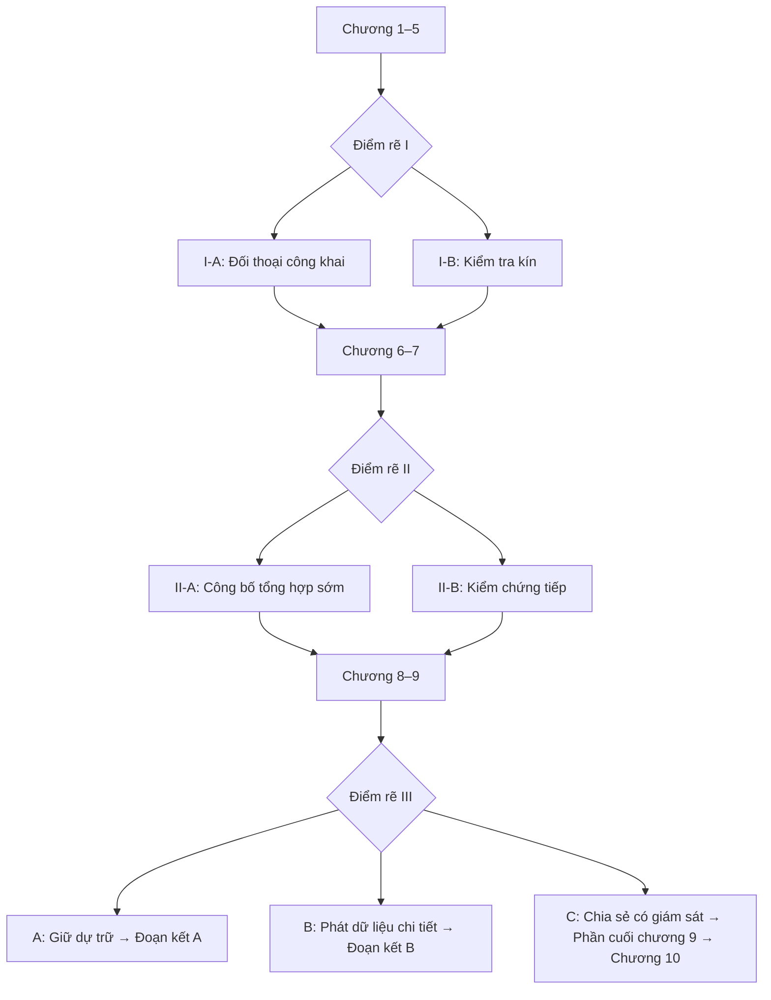
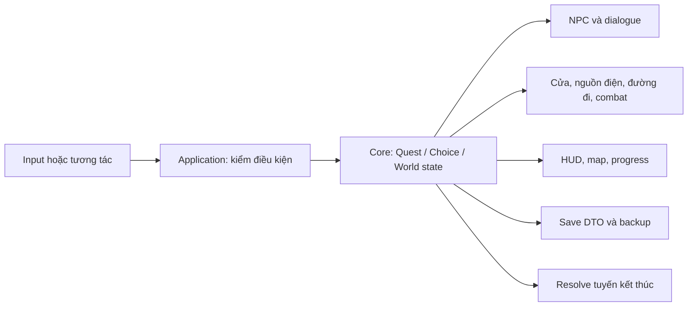

# GAME DESIGN BLUEPRINT — UNITY 3D
## Những người không có chỗ dưới bầu trời

**Phiên bản:** 1.0 — 04/11/2026.  
**Nguồn thiết kế:** [PLAN.md](PLAN.md), chuyển đầy đủ sang Unity 3D; cốt truyện chuẩn ở [STORY.md](STORY.md).  
**Thể loại:** một người chơi, hành động phiêu lưu 3D góc nhìn thứ ba, điều tra và lựa chọn có hậu quả.  
**Engine:** Unity 6, C#, Universal Render Pipeline (URP).  
**Nền tảng đầu tiên:** Windows x64, bàn phím/chuột; gamepad sau khi vòng chơi chính ổn định.  
**Hướng hình ảnh:** nhân vật và môi trường 3D stylized sci-fi; model có rig, animation, vật liệu và ánh sáng thật trong scene.  
**Tài liệu thi công:** [WORKFLOW.md](WORKFLOW.md).

Đây là kế hoạch cho phiên bản 3D, chưa phải xác nhận đã chuyển bản đang chơi thành 3D. Lượt công việc này tạo tài liệu. Khi triển khai, dùng project dự kiến `Game3D` bên cạnh `Game` để giữ bản đã chạy được làm mốc đối chiếu dữ liệu. Không lấy các class sprite/khung hình của bản hiện tại làm controller 3D.

## 1. Nguyên tắc chuyển thể

### 1.1. Nội dung được giữ từ PLAN.md

- Ba trụ cột: hành động, điều tra/di chuyển, quyết định có hậu quả.
- Mai có bộ thiết bị kiểm định công trình; chiến đấu chủ yếu với máy tự động.
- Ba lớp không gian: Lõi Sáng, Vành Đệm, Rìa Mưa; các khu có trạng thái trước bão, trong bão và sau bão.
- Kế hoạch đủ 10 chương, ba điểm rẽ, 12 tổ hợp lựa chọn chính.
- Một vertical slice có khám phá, combat, điều tra, hội thoại, save và hậu quả nhìn thấy được.
- Chiến đấu tạo điều kiện tiếp cận/cứu hộ; quyền quyết định về nguồn lực vẫn thuộc câu chuyện và cộng đồng.

### 1.2. Phân biệt truyện gốc và phần chuyển thể

STORY.md có điều tra hồ sơ, mâu thuẫn xã hội, khủng hoảng nguồn lực và bão. Các kỹ năng xung điện, drone chiến đấu, mini-boss và boss trong tài liệu này là **sáng tạo chuyển thể lấy từ PLAN.md**, không khẳng định chúng đã xuất hiện trong truyện gốc. Chúng được giữ trong phạm vi thiết kế Unity 3D theo yêu cầu hiện tại.

Mỗi nhiệm vụ có hai lớp dữ liệu: `canonBeats` ghi sự kiện/thoại từ truyện; `adaptationBeats` ghi thử thách hành động thêm vào. Ghi rõ nguồn và vị trí chèn để biên tập kiểm tra. Một màn hành động mới không được tự đổi người sống/chết, vai trò nhân vật hoặc đường rẽ của nguyên tác.

### 1.3. Nhân vật và xung đột

| Thành phần | Vai trò phải giữ |
| --- | --- |
| Mai | Kiểm toán viên tin vào quy trình, dần nhận ra giới hạn và trách nhiệm của chính mình. Trang bị có nguồn gốc bảo trì/kiểm định. |
| An | Đứa trẻ sửa ô, có mục tiêu và quan hệ riêng; tạo gắn bó qua sinh hoạt, không chỉ là đối tượng hộ tống. |
| Hạ | Tiếng nói cộng đồng, chủ động tổ chức và có quyền bác bỏ đề xuất của Mai. |
| Linh | Kỹ sư đối chiếu dữ liệu, giữ ổn định kỹ thuật và phản biện phương pháp điều tra. |
| Thu | Bác sĩ đứng giữa nhu cầu bệnh nhân và giới hạn nguồn lực. |
| Khang | Người tham gia thiết kế hệ thống với thiện chí, lịch sử và thỏa hiệp phức tạp. |
| Vinh | Đại diện ưu tiên ổn định; có lập luận và trách nhiệm, không thành phản diện đơn giản. |
| Tường | Nhân chứng về cảnh báo bị trì hoãn; cung cấp dấu vết có thể kiểm chứng. |
| Thành phố | Mái vòm, mạng điện/khí, hồ sơ cư trú, lao động và điểm công dân liên hệ trực tiếp với đời sống. |

Điểm nhấn điều tra ở chương 7; khủng hoảng tăng ở chương 8; cao trào lựa chọn ở chương 9. Chương 10 là hậu quả trên tuyến C. Các kết thúc A/B có đoạn kết riêng.

## 2. Vòng lặp và trải nghiệm người chơi

**Vòng ngắn, mục tiêu thiết kế 3–7 phút:** quan sát → phát hiện nguy hiểm/sai lệch → xử lý máy hoặc puzzle → thu chứng cứ/mở đường → đối chiếu với NPC → thấy thay đổi trong khu vực.

**Vòng nhiệm vụ, mục tiêu 20–40 phút:** nhận nhu cầu cụ thể → khảo sát các cách tiếp cận → hành động/di chuyển → phát hiện chứng cứ làm phức tạp vấn đề → lựa chọn → NPC và môi trường phản hồi.

**Toàn game:** trải nghiệm ba lớp thành phố → kiểm chứng niềm tin của Mai → hình thành lòng tin và bộ bằng chứng → bão buộc phân bổ nguồn lực → phương án cuối và hậu quả.

Tỷ lệ tham khảo giữ từ PLAN.md: 40% hành động/di chuyển nguy hiểm, 25% khám phá/puzzle, 20% điều tra, 15% thoại/cutscene. Đây là giả thuyết để đo khi playtest, không dùng ép thêm trận đánh vào mọi cảnh. Các cảnh gia đình, bệnh viện và ngày đi chơi của An cần đủ khoảng lặng.

## 3. Nhân vật, camera và điều khiển 3D

### 3.1. Controller

- Dùng `CharacterController` cho Mai; di chuyển trên mặt phẳng XZ, trục Y là cao độ, trọng lực do motor xử lý. Kiểu điều khiển này phù hợp với nhân vật góc nhìn thứ ba không dùng Rigidbody làm nguồn điều khiển chính. [Unity Character Controller](https://docs.unity3d.com/6000.4/Documentation/Manual/class-CharacterController.html).
- Camera phối cảnh theo sau Mai, xoay bằng chuột; hướng WASD dựa trên phương ngang của camera. Có xử lý tường, trần thấp, cầu thang và mép sàn.
- Cinemachine Third Person Follow theo một `CameraTarget` xoay độc lập với model; script riêng đọc Look input và điều khiển target. [Cinemachine Third Person Follow](https://docs.unity3d.com/Packages/com.unity.cinemachine@3.1/manual/CinemachineThirdPersonFollow.html).
- Một nguồn di chuyển duy nhất ở mỗi trạng thái: locomotion do motor; root motion chỉ bật có kiểm soát cho động tác đã thiết kế. Animator và motor không đồng thời kéo nhân vật.
- Nhân vật là mesh có rig. Tranh nền, sprite xoay theo camera hoặc chuỗi ảnh không thay thế model/animation của gameplay 3D.

### 3.2. Bộ phím thiết kế

| Phím | Chức năng |
| --- | --- |
| WASD / chuột | Di chuyển / xoay camera trong gameplay |
| Shift / Space / Ctrl | Chạy / nhảy ở đoạn cho phép / cúi tại tuyến được thiết kế |
| F | Tương tác, trò chuyện, nhặt vật phẩm, thao tác cửa |
| Q | Bật/tắt máy quét kiểm toán |
| R | Xung nhiễu kỹ thuật |
| G | Móc cáp tại điểm neo hợp lệ |
| Chuột trái / phải | Tấn công / đỡ hoặc chống đỡ đúng nhịp |
| Alt | Né |
| M / Esc | Bản đồ khu vực / pause |
| Enter, Space hoặc F trong thoại | Đọc tiếp; action map thoại chặn nhảy/tấn công |

Chia Input Actions thành Gameplay, Dialogue, UI, Cutscene. Mở menu trả con trỏ và khóa input gameplay. Đóng menu phục hồi đúng chế độ. F được giữ làm tương tác; chức năng quét F trong PLAN.md cũ chuyển sang Q để tránh xung đột với yêu cầu điều khiển đã thống nhất. Cúi, móc cáp và gamepad triển khai sau motor/combat cơ bản.

## 4. Combat và thiết bị kỹ thuật

### 4.1. Phạm vi ban đầu

Một vũ khí, hai khả năng chủ động, một arena và tối đa hai loại địch trước khi mở rộng. Không triển khai đồng thời cây kỹ năng lớn, craft, loot ngẫu nhiên và open world.

| Thiết bị | Cơ chế | Phạm vi |
| --- | --- | --- |
| Gậy xung điện | Combo nhẹ ba đòn, đòn nặng, đỡ, làm choáng máy | Combat prototype |
| Xung nhiễu | Ngắt hành động/giáp máy trong thời gian ngắn; hồi chiêu | Combat prototype |
| Máy quét kiểm toán | Phát hiện điểm yếu, dòng điện, dấu chỉnh sửa log | Combat + điều tra |
| Móc cáp | Đi qua khoảng trống tại điểm neo, hỗ trợ tuyến cứu hộ | Sau locomotion/puzzle cơ bản |
| Cầu nối điện tạm | Phân bổ nguồn cho cửa, bơm, khí hoặc tuyến cứu hộ | Puzzle và nhiệm vụ |

### 4.2. Quy tắc kỹ thuật combat

- State rõ: Locomotion, Attack, Guard, Dodge, HitReact, Disabled. Mỗi trạng thái quy định input được nhận, cửa sổ hủy động tác và animation.
- Damage chỉ phát trong cửa sổ đánh; mỗi mục tiêu nhận một lần cho mỗi `attackInstanceId` dù có nhiều collider.
- Animation signal có thể mở hit window; damage/state do hệ thống gameplay quyết định và được kiểm thử khi pause hoặc animation bị ngắt.
- Địch báo đòn bằng chuyển động/ánh sáng/âm thanh trước khi hit; máy bị vô hiệu hóa phản hồi rõ.
- HP/stagger/cooldown là tài nguyên chiến đấu. Lòng tin, chất lượng chứng cứ và quyền riêng tư là hệ quả nhiệm vụ riêng.
- Lỗi địch/NavMesh, đóng menu hoặc load checkpoint không được để nhân vật mắc trong hitbox, bất tử ngoài ý muốn hay bị damage từ đòn đã hủy.

### 4.3. Địch và boss lấy từ PLAN.md

| Loại | Thiết kế | Yêu cầu triển khai Unity |
| --- | --- | --- |
| Drone tuần tra | Đòn có nhịp, điểm yếu lúc quét | FSM, cảm biến, đường bay có giới hạn; không dùng NavMesh mặt đất để tự giả bay |
| Robot bảo trì | Chậm, đòn diện rộng, có thể sửa bộ điều khiển | NavMeshAgent, vùng báo đòn, trạng thái vô hiệu hóa/chuyển quyền điều khiển |
| Drone hộ vệ | Che chắn đường hoặc bảo vệ trạm tín hiệu | Kiểm tra đường nhìn và liên kết nguồn giáp |
| Trạm khóa Rìa Mưa | Mini-boss: ngắt mạch để mở tuyến cho cư dân | Boss state + ba điểm thao tác, lưu phase tại checkpoint an toàn |
| Bộ giám sát lưu trữ | Tìm log và vô hiệu hóa ba node | Bằng chứng và node dùng ID ổn định, không chỉ trừ HP |
| Bộ ổn áp mái vòm | Các phase phản ánh tuyến điện đã xử lý | Dữ liệu world state điều khiển nguồn, nguy hiểm và tuyến cứu hộ |

Xung đột với cư dân, cán bộ và bệnh nhân chủ yếu xử lý qua hội thoại/quyết định. Hạ và cộng đồng tiếp tục có hành động độc lập với chiến thắng của Mai.

## 5. Thế giới, level và bản đồ

| Khu | Hình ảnh 3D | Chức năng |
| --- | --- | --- |
| Lõi Sáng | Tầng nhà cao, kính, mái vòm, ánh sáng ổn định | Cơ quan, học viện, gia đình, phiên điều phối |
| Vành Đệm | Nhà xưởng, tuyến ray, ống dẫn, kho, trạm y tế | Puzzle vận hành, lao động, tuyến giao nhận và hành động |
| Rìa Mưa | Nhà thấp, mái che nối nhau, nước, đường bảo trì | Điều tra dân cư, An/Hạ, cứu hộ, phản ứng cộng đồng |

Dùng hub có giới hạn và các scene nhiệm vụ liên thông. Dựng modular kit cho sàn, tường, cửa, cầu thang, hành lang, ống, biển và đồ sinh hoạt. Một level có nhiều trạng thái thời tiết/nguồn điện bằng dữ liệu; tránh nhân bản cả map cho từng nhánh.

Mỗi khu vực có `areaId`, bounds, tầng/cao độ, điểm spawn, cửa nối, vùng NPC và điểm chứng cứ. M mở map lấy vị trí thật của Mai theo bounds và tầng. Hiện cầu thang, cửa và vùng chưa tới; không vẽ một sơ đồ phẳng làm mất cao độ. Thông tin chapter/map nằm trong map, pause và progress; HUD chơi thường giữ gọn.

Môi trường có sinh hoạt: lịch NPC, xe điện xa, quạt/bơm, cửa, dây/cây rung nhẹ, bụi/khói, phản xạ và âm thanh theo khu vực. Các yếu tố này phải phản hồi trạng thái mất điện/bão. NPC nhường đường ở cửa hẹp, không chắn điểm thao tác chính.

## 6. Mười chương thành nhiệm vụ 3D

| Chương | Nhịp truyện và điều tra | Chuyển thể gameplay 3D |
| --- | --- | --- |
| 1. Thành phố công bằng | Hồ sơ 8-12 bằng 0 trái với dấu hiệu sinh hoạt; công việc, Linh, Vinh và gia đình | Khám phá cơ quan/phòng lịch sử/căng tin/phòng họp/căn hộ; xem ảnh, thao tác bảng điện, đối chiếu hồ sơ. Tutorial ở Guide; thử combat riêng bằng khu huấn luyện kỹ thuật nếu cần, không sửa sự kiện chương thành trận drone ở Vành Đệm. |
| 2. Những chiếc ô hỏng | Gặp An/Hạ, nhìn đời sống Rìa Mưa, tra dấu lao động | Đi qua công trường/ngõ ngập, sửa tuyến và mở đường; hai tuyến khám phá, có robot trục trặc ở đoạn bổ sung. |
| 3. Người có điểm bằng không | Vòng điều kiện cư trú/lao động/đóng góp | Tiếp cận trạm dữ liệu, đối chiếu sổ/log, puzzle nguồn, combat phòng vệ tại tuyến bổ sung được ghi rõ. |
| 4. Một ngày dưới mái vòm | An trải nghiệm trung tâm và quan hệ mới | Không gian học viện/thành phố, mini-game, tương tác vật thể và hội thoại; ưu tiên ký ức tích cực. |
| 5. Giá của một mạng người | Cấp cứu và cái giá chuyển nguồn | Tuyến y tế, khôi phục điện, robot bảo trì cản đường, lựa chọn trách nhiệm; điểm rẽ I. |
| 6. Một hệ thống đúng đắn | Gặp Khang, tìm quy định/lịch sử bị khuất | Kho cũ, đối chiếu bản quy chế; thử thách bộ giám sát lưu trữ là lớp chuyển thể, không biến lời khai Khang thành phần thưởng đánh boss. |
| 7. Những con số biết nói dối | Đối chiếu dân số, Tường, lịch sử trì hoãn và chữ ký Mai | Bảng chứng cứ nhiều nguồn, khảo sát, truy vết log được phép; bổ sung nguy hiểm máy ở tuyến bảo trì, giữ nguyên đình chỉ Mai và điểm rẽ II. |
| 8. Ngày mái vòm đóng lại | Bão đến, sai lệch dữ liệu trở thành đe dọa sinh tồn | Sơ tán, cứu hộ, nối nguồn, hành động ở cơ sở hạ tầng; tác động của việc trước xuất hiện ở đường và NPC. |
| 9. Quyền được tồn tại | Phiên điều phối và ba hướng quyết định | Bảo vệ đường truyền/ổn áp ở đoạn hành động; trình bày chứng cứ, tranh luận và chọn A/B/C. Combat không tự chọn thay cộng đồng. |
| 10. Sau cơn mưa | Hậu quả và trách nhiệm trên tuyến C | Khám phá thành phố sau bão, điều trần, đối thoại và biến thể world state. A/B đi tới đoạn kết riêng, không bị nối vào chương 10. |

Khác biệt có chủ đích với bảng chương trong PLAN.md: chương 1 bám các địa điểm nguyên tác; các màn máy móc/hành động được đặt như phần chuyển thể, không viết lại canon thành nội dung đã có sẵn.

### 6.1. Nhiệm vụ mẫu — Chương 5: Giá của một mạng người

Mục tiêu thời lượng 25–35 phút, cần đo lại bằng chơi thử.

1. Thu mô tả tình trạng bệnh nhân và nguồn điện, cùng giới hạn của các phương án.
2. Đường tới khu điều áp có chập điện và máy tự động trục trặc; người chơi đọc báo đòn, dùng xung nhiễu, mở tuyến.
3. Tại bảng điện, thu số liệu thời gian/công suất và chọn thứ tự khôi phục máy trợ thở, vận chuyển bệnh nhân.
4. Robot kẹt ở cụm bơm tạo mini-boss; giải cơ chế cầu dao xen với đỡ/né. Các thao tác có idempotency, không phát thưởng hai lần khi load.
5. Trở lại bệnh viện, kết quả cứu người và ảnh hưởng với người phải chờ được trình bày đúng nguyên tác.
6. Chọn I-A: xem lại công khai với hội đồng bệnh nhân, hoặc I-B: kiểm tra kín trước khi phát hành. Lưu lựa chọn và phản ứng liên quan.

## 7. Điều tra, bằng chứng và AI

**Bằng chứng:** mỗi mục có `evidenceId`, nguồn, thời điểm, người cung cấp, `cueId`/đoạn truyện liên quan và trạng thái Chưa xem / Đã xem / Đã kiểm chứng. Bằng chứng đã tìm không đồng nghĩa kết luận đã đúng.

**Vòng suy luận:** thu ảnh/log/lời khai → đặt cạnh nhau → nhận diện mâu thuẫn → chọn cách xác minh → mở kết luận đủ điều kiện. Ví dụ chương 1: dấu sinh hoạt trong ảnh cho phép đề nghị khảo sát, không cho phép suy ra chính xác số cư dân. Chương 7 cần loại trừ rò nước, xưởng ca đêm và sai số.

**AI gameplay:** NPC dùng lịch và state machine C#; nhân vật đi bộ có NavMesh, cảm biến nhìn/nghe và phản ứng theo world state. Navigation là hệ tìm đường; hành vi và lựa chọn nhiệm vụ do hệ riêng quản lý. [Unity AI Navigation](https://docs.unity3d.com/Packages/com.unity.ai.navigation@2.0/manual/index.html).

**AI tạo sinh là mở rộng sau vertical slice:** trợ lý phân tích hoặc diễn đạt câu trả lời NPC dựa trên chứng cứ đã mở. Kết quả phải nêu nguồn và điều chưa chắc; model không tự ghi choice, mở ending hoặc tạo thêm sự kiện canon. Gameplay chính chạy được khi tính năng này tắt. Nếu dùng dịch vụ ngoài, khóa truy cập nằm ở backend; chỉ gửi dữ liệu game đã cho phép, có xử lý timeout và câu trả lời viết sẵn dự phòng.

## 8. Phân nhánh và hậu quả



| Biến | Dạng | Hậu quả cần thể hiện |
| --- | --- | --- |
| `choice_hospital` | I_A / I_B | Cảnh theo dõi sau cứu chữa, Hạ/Thu/gia đình bệnh nhân |
| `choice_evidence` | II_A / II_B | Thời điểm cảnh báo, nguồn xác minh và quan hệ cư dân |
| `choice_final` | A / B / C | Resolve đúng tuyến kết thúc |
| `trust_ria_mua` | Thang có mô tả, dự kiến -3…3 | Sự tự nguyện hợp tác, tuyến cứu hộ, lời thoại |
| `evidence_quality` | Dự kiến 0…3 + các evidence ID | Chất lượng lập luận và điều kiện thực hiện |
| `privacy_risk` | Dự kiến 0…3 + event ID | Hậu quả tiết lộ dữ liệu và yêu cầu giải trình |
| `grid_stability` | Dự kiến 0…3 + node state | Tuyến điện, cảnh báo, nguy hiểm và dự trữ |
| `hospital_followup` | Trạng thái nhiệm vụ | Phản hồi bệnh nhân, thời hạn và lời hứa |

Các thang số trên là thiết kế nội bộ, chưa phải thông số đã cân bằng. Không gộp thành thanh thiện/ác. Người chơi thấy cả ba phương án cuối; chất lượng chuẩn bị thay đổi điều kiện, phản ứng và hệ quả, không khóa một “ending tốt” bằng điểm bí mật. Kiểm thử AA/AB/BA/BB × A/B/C = 12 tuyến chính.

## 9. Kiến trúc Unity/C#

### 9.1. Project và package

Project dự kiến `Game3D`, bộ mã namespace `Civi.ThreeD`. Mốc Editor trên máy hiện có là 6000.4.0f1; lúc khởi tạo 3D phải kiểm resolve/compile/build rồi khóa phiên bản trong `ProjectVersion.txt` và `packages-lock.json`. Không gọi đây là phiên bản mới nhất hay tự nâng Editor giữa sprint.

| Hệ | Lựa chọn Unity |
| --- | --- |
| Render | URP, Universal Renderer cho 3D; material Lit hoặc shader stylized cùng pipeline. [URP](https://docs.unity3d.com/6000.4/Documentation/Manual/urp/urp-introduction.html) |
| Điều khiển | Input System, Input Actions và action maps; cấu hình version theo Editor. [Input Actions](https://docs.unity3d.com/Packages/com.unity.inputsystem@1.20/manual/Actions.html) |
| Player | CharacterController + C# motor, interaction query, state/combat components |
| Animation | Animator, Avatar, Blend Tree, animation clips; kiểm rig và retarget. [Mecanim](https://docs.unity3d.com/6000.4/Documentation/Manual/AnimationOverview.html) |
| Camera/cutscene | Cinemachine 3.x đã kiểm tương thích; Timeline cho cảnh có trình tự. [Timeline](https://docs.unity3d.com/Packages/com.unity.timeline@1.8/manual/index.html) |
| NPC | AI Navigation cho đường đi trên mặt đất + FSM/schedule C# |
| Dữ liệu | ScriptableObject cho định nghĩa; DTO/runtime state riêng cho tiến độ |
| UI | Canvas/uGUI + TextMeshPro; Animator/tween C# cho panel; ảnh progress lấy từ gameplay Unity |
| Save | JSON DTO có schema, stable ID, ghi nguyên tử, backup, migration và validation |
| Scene | Bootstrap bền vững + menu + scene khu vực tải bất đồng bộ; Addressables chỉ thêm khi có nhu cầu asset thực |

Các package nêu trên là cấu hình dự kiến, không phải danh sách đã cài trong project hiện tại. Workflow quy định kiểm package trước khi viết code phụ thuộc.

### 9.2. Cấu trúc dự kiến

```text
Game3D/Assets/_Civi3D/
  Scripts/{Core,Application,Infrastructure,Gameplay,Presentation,Composition}/
  Editor/Build/
  Data/{Chapters,Dialogue,Quests,Choices,Evidence,Combat,Areas}/
  Scenes/{Bootstrap,Menu,Hubs,Missions,Tests}/
  Prefabs/{Player,NPC,Enemies,Interactables,UI,World}/
  Art/{Characters,Environment,Materials,Textures,Lighting,VFX}/
  Animation/{Rigs,Clips,Controllers,Timelines}/
  Audio/{Music,Ambience,SFX,Voices}/
  Tests/{EditMode,PlayMode}/
```

Core chứa logic trạng thái thuần C#; Application điều phối use case; Infrastructure thực hiện IO/nạp dữ liệu; Gameplay nối Unity physics/Animator/AI; Presentation hiển thị; Composition dựng và nối dịch vụ. Editor có assembly riêng và không lọt vào build player. Chi tiết dependency và class nằm ở WORKFLOW.md.

### 9.3. Luồng xử lý



UI và animation không tự đổi nhiệm vụ. Tất cả kết quả đi qua command có ID, điều kiện và event đầu ra. Scene/prefab giữ reference hoặc stable ID; không rẽ nhánh bằng tên GameObject.

## 10. Model, animation và render

### 10.1. Hướng mỹ thuật

Nhân vật 3D stylized/anime có tỉ lệ và rig thống nhất; chốt bằng một model Mai thử nghiệm trước khi sản xuất cả dàn. Model thường là mặc định của bản thiết kế 3D này. Nếu về sau chọn chibi 3D thì cần duyệt lại rig/camera/va chạm như một biến thể mỹ thuật, không quay về cách dựng gameplay bằng sprite.

Mỗi nhân vật cần mesh, UV, texture/material, rig/skin, Avatar hoặc Generic rig hợp lệ, animation và prefab. Ảnh concept hỗ trợ tạo hình; không phải file model có thể tự đưa vào Unity để thành nhân vật 3D.

Locomotion tối thiểu: idle, walk, run, quay hướng, start/stop; combat: attack, guard, dodge, hit, disabled; đời thường: nói chuyện, xem hồ sơ, ngồi, thao tác bảng điện. Tối ưu bàn chân, tiếp xúc tay và hướng nhìn trước khi thêm biểu cảm nâng cao.

### 10.2. Pipeline render

- Dựng level bằng geometry có collision; thiết lập vật liệu URP và thang đo nhất quán.
- Ánh sáng tĩnh dùng bake khi phù hợp; nhân vật di động có probe giải pháp đã kiểm trong Editor, reflection probe cho kính/kim loại. Light trực tiếp, emissive và trạng thái mất điện phải có quy tắc riêng.
- Thiết lập môi trường, key/fill, exposure, color grading, bloom vừa phải và bóng. Kiểm mặt nhân vật dưới cả ánh sáng trong nhà và ngoài trời.
- VFX là particle/mesh/shader được giới hạn về lượng trong khung hình; giảm hiệu ứng phải vẫn đọc được báo đòn và mục tiêu.
- Render gameplay thời gian thực trong Unity là nguồn duyệt chính. Render đẹp trong phần mềm tạo model chưa đủ chứng minh material/rig hoạt động trong game.
- Mục tiêu ban đầu 1080p/60 FPS trên PC mục tiêu được ghi cấu hình khi bắt đầu benchmark. Đây là ngân sách thiết kế, chưa có kết quả đo cho bản 3D.

Bắt đầu với một phòng thử ánh sáng và một tuyến level xám; chỉ làm art pass sau khi controller/camera/combat đọc rõ. Chi tiết import, bake, capture và profile theo từng bước ở WORKFLOW.md.

## 11. Menu, pause, progress và save

Giữ các quyết định trải nghiệm đã thống nhất, triển khai bằng UI và scene 3D:

- Menu trái có tên/nút, phải là nhân vật và bối cảnh 3D có animation nhẹ. Bắt đầu mở lượt mới; Tiếp tục xuất hiện khi checkpoint hợp lệ; Hướng dẫn, Cài đặt, Credits, Thoát.
- Fade/blend có khóa input khi vào game, tải khu vực và chuyển cutscene; panel có animation mở/đóng/hover.
- Esc pause: Tiếp tục, Tiến trình, Cài đặt, Trở về màn hình đầu. Pause đóng băng AI, combat, animation và đồng hồ gameplay; UI/fade dùng thời gian không scale.
- Progress có 10 ô chương: đã chơi sáng, ảnh gameplay thật; chưa chơi xám không ảnh; lưu hiện tại và lịch sử hoàn thành tách biệt.
- Guide ở menu đầu; HUD không có tên chương/map, nút pause hoặc dải hướng dẫn thường trực. Giữ thông tin chiến đấu cần thiết như HP/cooldown khi vào combat.
- Tự lưu trước khi về menu/thoát và ở checkpoint. Lỗi ghi giữ game mở và cho thử lại. Không nhận snapshot ở giữa một state transition chưa nhất quán.

Save 3D có `schemaVersion`, `contentVersion`, chapter/node/cue ID, quest/evidence/choices, `areaId`, `spawnId`, vị trí XYZ/hướng và world/combat checkpoint state. Không lưu reference scene hoặc AnimationState dạng số ngẫu nhiên. Load tái dựng từ stable ID rồi validate collider/NavMesh/spawn.

Save bản đang chơi dùng tọa độ 2D và hash riêng; nếu cần nhập sang 3D, viết migration chỉ lấy tiến độ có thể đối chiếu rồi dùng spawn 3D hợp lệ. Giữ nguyên file gốc. Không chép thẳng x/y cũ thành x/y/z mới.

## 12. Phạm vi sản xuất và các mốc

### 12.1. Thứ tự thực hiện

1. **Nền tảng 3D:** project, URP, motor/camera, một Mai có rig và một phòng thử render.
2. **Combat prototype:** arena xám, gậy, xung nhiễu, hai máy địch và một puzzle. Đo cảm giác điều khiển trước art pass.
3. **Chương 1 3D:** dùng bộ thoại đã duyệt và 5 khu nội thất để kiểm đường đi, NPC, hồ sơ, menu, map và save. Đây là mốc chuyển thể nội dung đầu tiên.
4. **Vertical slice theo PLAN.md:** lấy chương 2–3 làm xương sống, Rìa Mưa với hai tuyến, An/Hạ, hai drone và mini-boss, một lựa chọn nhỏ có hậu quả quan sát được.
5. **Hoàn thiện demo:** render/audio/VFX, accessibility, input, save, performance và người chơi ngoài nhóm.
6. **Mở chiến dịch:** chỉ sau khi đo được tốc độ sản xuất; triển khai các chương tiếp cùng điểm rẽ và ending.

### 12.2. Vertical slice

Mục tiêu trải nghiệm 45–60 phút, cần kiểm bằng playtest: một đoạn dẫn từ Lõi Sáng, khu Rìa Mưa chính, hai tuyến khám phá, motor/combo/đỡ/né/quét/xung nhiễu, hai kiểu drone, một mini-boss, An/Hạ và hai cư dân phụ, một nhiệm vụ log/nguồn điện, một lựa chọn có hai hậu quả rõ, menu/map/dialogue/save hoàn chỉnh.

Lựa chọn nhỏ trong demo phải ghi là nội dung bổ sung, không giả làm một trong ba điểm rẽ nguyên tác nếu chưa đến đúng chương. Phải hoàn thành được offline khi AI tạo sinh tắt.

### 12.3. Ước lượng và nhân lực

Giữ khung tham khảo PLAN.md cho nhóm giả định 5 người bán thời gian: tiền sản xuất 2–3 tuần; combat 3–5 tuần; narrative 2–3 tuần; vertical slice 6–10 tuần; polish 2–4 tuần. Mốc 4–6 tháng chỉ là giả thuyết khi có kỹ năng và asset phù hợp, chưa phải cam kết cho đội hiện tại. Việc bổ sung chương 1 3D, làm model riêng hoặc học pipeline mới cần được tính thêm sau prototype.

| Vai trò | Đầu ra sở hữu | Hợp đồng giao tiếp |
| --- | --- | --- |
| Gameplay programmer | Motor, input, combat, enemy runtime | Command/event, damage và interaction interfaces |
| Narrative programmer | Quest, choices, evidence, dialogue, save | Stable ID, schema, test route |
| Level/technical artist | Blockout, collision, NavMesh, lighting | Area, door/spawn ID, asset và render budget |
| Character/animation artist | Model, rig, clips, Animator, VFX | Rig convention, clip/signal contract |
| Writer/producer/UI-audio | Script, nhịp nhiệm vụ, UI/audio, playtest | Cue/source ID, review và tiêu chí nghiệm thu |

Đây là cách chia trách nhiệm, không gán tên hoặc số thành viên thật. Prototype dùng asset tạm có kiểm soát để code, scene và animation tích hợp sớm.

## 13. Kiểm thử, quản lý phiên bản và rủi ro

**Code/data:** EditMode test nhánh, điều kiện chứng cứ, damage một lần, version/migration; PlayMode test input, controller, camera, enemy, door transition, pause và save/load; chạy 12 tuyến chính khi toàn chiến dịch có nội dung.

**Render:** ảnh cố định camera/quality ở phòng test, level nội thất, Rìa Mưa, combat và bão; clip animation và số đo CPU/GPU/memory. Người chơi không mắc kẹt, camera không xuyên tường, nhân vật không trượt chân rõ, chữ/đòn vẫn đọc được khi giảm hiệu ứng. Dùng [Unity Profiler](https://docs.unity3d.com/6000.4/Documentation/Manual/Profiler.html) để đo thay vì kết luận bằng FPS trong Editor.

**Version control:** commit Assets cùng `.meta`, Packages, ProjectSettings; bật Visible Meta Files/Force Text; scene/prefab chia theo khu vực và owner; asset lớn theo chính sách Git LFS đã thống nhất. Cache/Library/Temp/build không commit. Đổi Editor/package trên nhánh kiểm chứng riêng; không đưa hướng dẫn `.uasset/.umap`, Blueprint, GAS hoặc Sequencer vào pipeline Unity.

| Rủi ro | Cách giới hạn và điều kiện kiểm |
| --- | --- |
| Quá nhiều hệ thống | Khóa một vũ khí, hai khả năng, một arena; các mốc có tiêu chí ra rõ |
| Combat tách khỏi truyện | Mỗi trận có mục đích mở tuyến/cứu hộ/chứng cứ, có phản hồi sau trận |
| Mai thành siêu chiến binh | Nguồn gốc thiết bị, phạm vi hành động và hậu quả được biên tập |
| NPC cộng đồng bị động | Có lịch, kế hoạch, phản biện và hành động khi Mai chưa tới |
| Nhánh giả hoặc sai ending | Payoff ít nhất hai cảnh/nhánh; A/B không tự đi vào chương 10 |
| Rig đẹp nhưng chơi kém | Kiểm animation trong Unity cùng camera/collision trước art hàng loạt |
| Render nặng | Đo scene stress; giảm bóng động, transparency, mật độ, vật liệu và LOD theo số liệu |
| Save cũ bị hỏng | Slot/schema 3D riêng, migration có test, backup và không ghi đè bản gốc |

## 14. Điều kiện hoàn thành và bước khởi động

Mỗi mốc phải có build Windows thật, đường chơi có thể lặp lại, kết quả test và ảnh/clip render từ Unity. Một asset render đẹp hoặc scene chạy được riêng không thay thế việc chơi hết nhiệm vụ.

Trước khi sản xuất các chương tiếp, trả lời bằng playtest: di chuyển/combat có rõ và thú vị; người chơi quan tâm An/Hạ; hiểu mâu thuẫn hồ sơ; thấy hậu quả sau lựa chọn; bản build đạt ngân sách trên máy đã ghi cấu hình.

**Bước thi công đầu tiên:** làm theo WORKFLOW.md từ W00 tới W04: kiểm repository, khởi tạo Game3D/URP, assembly/input, controller/camera và model rig trong phòng render thử. Sau đó thực hiện combat prototype và chương 1 3D, rồi vertical slice chương 2–3. Tài liệu này chưa tự tạo các scene, class hoặc asset được liệt kê.
