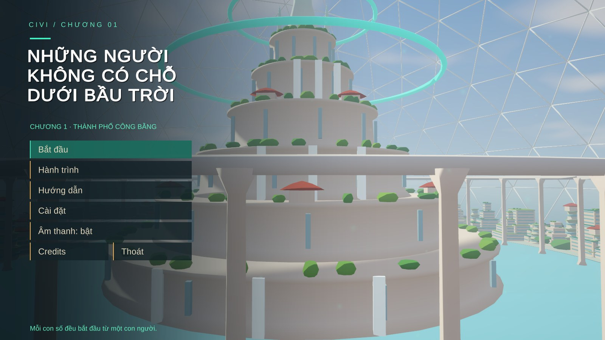
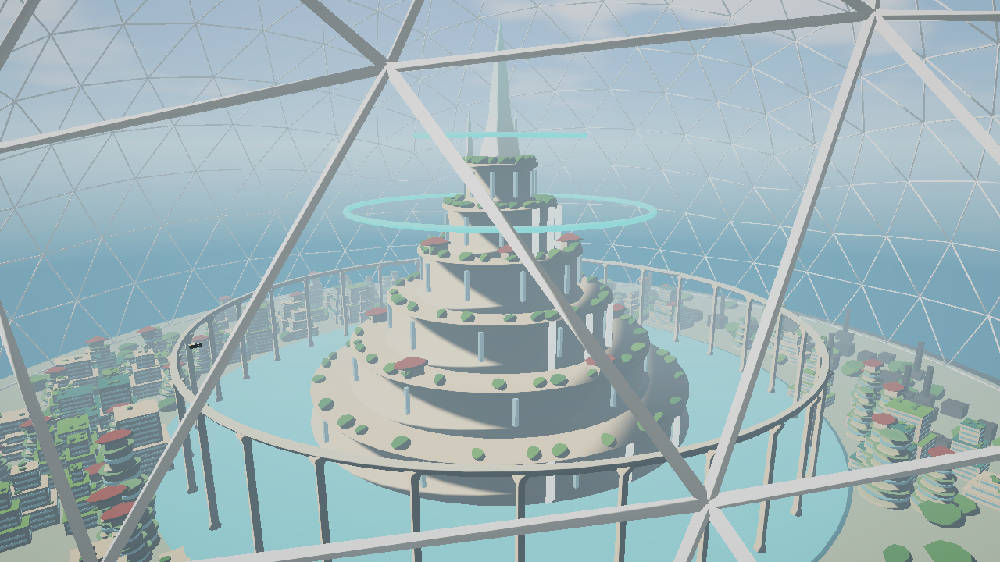
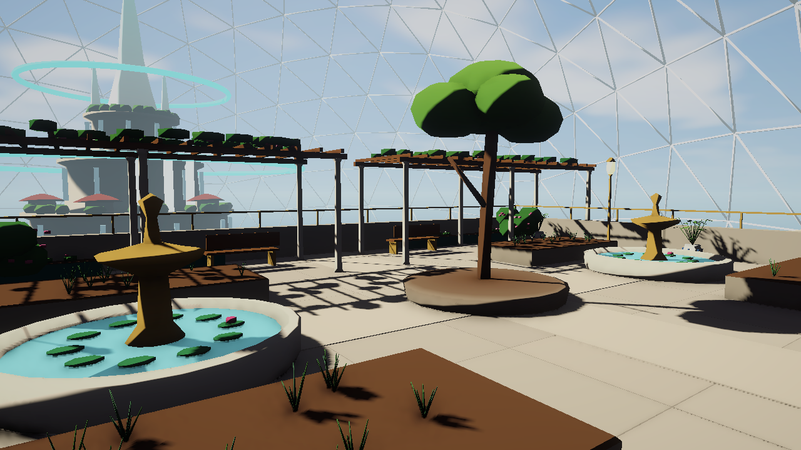
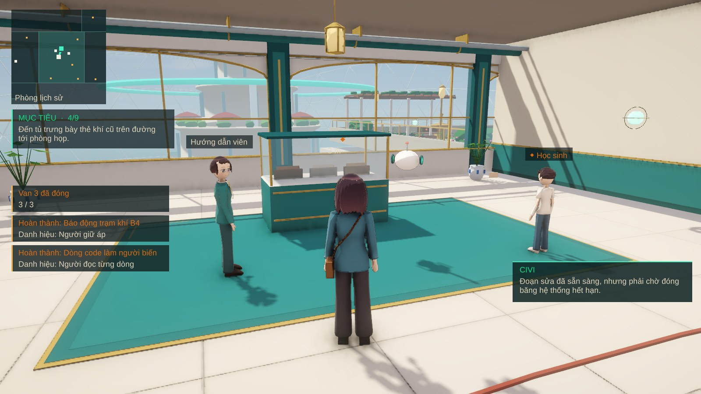
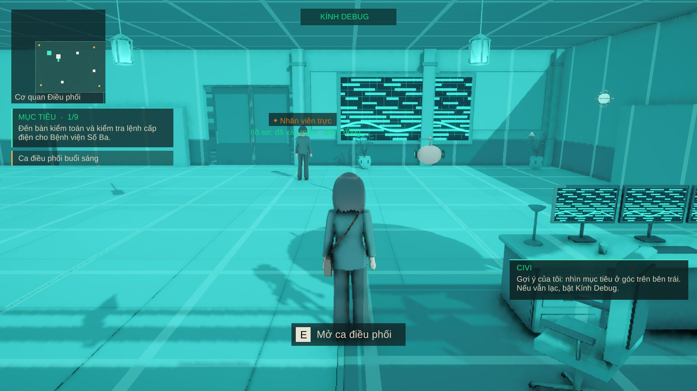
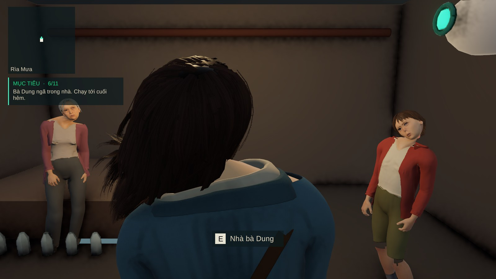
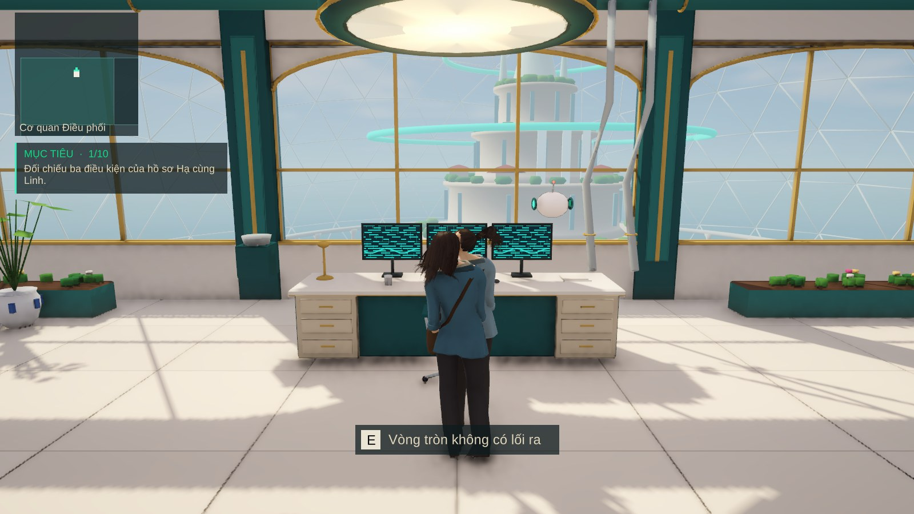
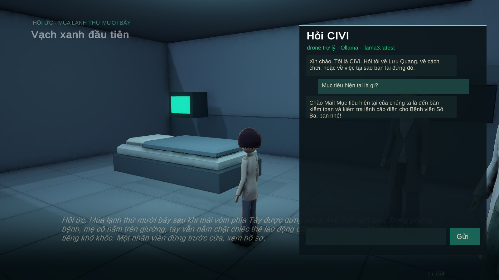
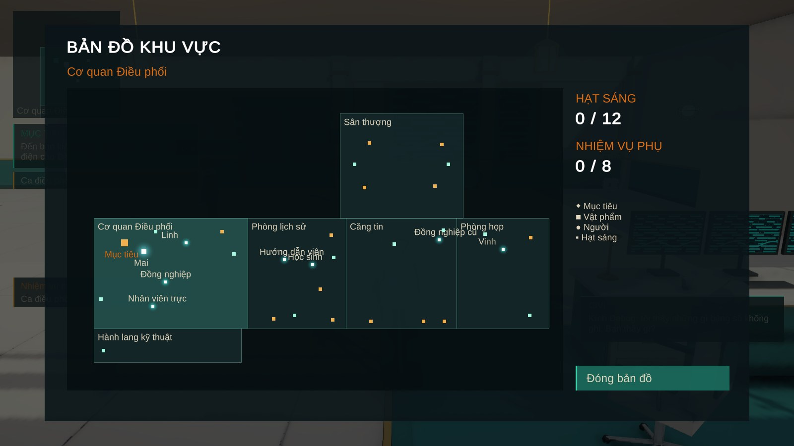

# CIVI — Những người không có chỗ dưới bầu trời

**A narrative-driven, third-person 3D game built with Unity.** CIVI explores a city where an automated social scoring system influences ordinary lives. Players follow the story, explore environments, interact with characters, and uncover information hidden beneath the city's rules.

**Project status:** playable prototype covering Chapters 1–3 · **Engine:** Unity `6000.4.0f1` (URP) · **Target:** Windows (x64) · **Language:** Vietnamese

> This is a development project, not a production-ready commercial release. Audio licensing, final sound balancing, and additional chapters remain open.

<p align="center">
  
</p>

## Highlights

- **Story-driven gameplay:** Chapters 1–3 of `STORY.md`, with approved dialogue in `dialogue/`.
- **3D exploration:** multiple interconnected locations, third-person movement, interactions, quests, inventory, and map/navigation.
- **Procedural content pipeline:** scripted Blender models, stylized characters, environments, and Unity scene generation.
- **Narrative systems:** quest progression, choices, debug lens, in-world terminal, inspection tools, and end-of-chapter reporting.
- **Optional AI interaction:** the “Hỏi CIVI” feature can use Claude or local Ollama, with predefined responses as fallback.

## Screenshots

*Real captures from the CIVI_8 Windows prototype. The art, user interface and scenes may evolve during development.*

| City beneath the dome | Exploring the terrace |
| :---: | :---: |
|  |  |
| **Character interaction and dialogue** | **Debug Lens** |
|  |  |
| **Chapter 2 — Rìa Mưa** | **Chapter 3 — Audit office** |
|  |  |
| **Ask CIVI — AI assistant** | **In-game map** |
|  |  |

## Play on Windows

1. For a **locally prepared copy** containing `release/CIVI/CIVI.exe`, double-click **`CHOI_GAME.bat`**.
2. For a **fresh Git clone**, install Unity **6000.4.0f1** with **Windows Build Support (IL2CPP)** and run the same launcher; it attempts to build the player if no executable exists.
3. Keep the entire `release/CIVI/` directory together when sharing a local build. The executable alone is not sufficient.

**Important:** the public-source layout intentionally does not include raw audio packs or generated audio clips while their redistribution rights remain unverified. For a fully voiced/sounded local build, authorized collaborators must provide the `AUDIO/` source packages and import them as described in [Development](docs/DEVELOPMENT.md). A fresh clone without those packs may run without the complete soundtrack.

### Controls

| Keys | Action |
| --- | --- |
| WASD / arrows | Move |
| Mouse / wheel | Look around / zoom |
| Shift / Space | Run / jump |
| E (or F) | Interact, inspect, continue dialogue |
| Q | Debug lens |
| M / B | Map / inventory |
| C | Ask CIVI |
| Hold Alt | Show pointer |
| 1–4 | Select an entry in contextual interfaces |
| Esc / P | Pause |
| F3 | Performance information |

## Repository structure

```text
CIVI/
├── Game/                       # Unity project (Assets, Packages, ProjectSettings)
│   └── Assets/_Civi/
│       ├── Scripts/            # C# gameplay, state, interactions, editors
│       ├── Resources/          # Chapter data and other Unity resources
│       ├── Models/             # Generated 3D assets
│       └── Scenes/             # Generated Unity scene
├── dialogue/                   # Approved Vietnamese chapter scripts
├── character-design/           # Visual references for the cast
├── source-assets/              # Source art; raw audio excluded from Git
├── AUDIO/                      # Local-only original audio packs (Git-ignored)
├── tools/
│   ├── blender/                # Procedural 3D model/world generation
│   └── ChapterTests/           # .NET domain and narrative test harness
├── docs/
│   ├── qa/                     # Reviewed dialogue and QA references
│   └── history/                # Historical planning / decisions
├── release/                    # Local Windows build (Git-ignored)
└── CHOI_GAME.bat               # Windows launcher
```

The `Game/Library/` Unity cache, temporary build output, local QA screenshots, and historical experiments are not part of the source repository.

## Development and verification

See [Development guide](docs/DEVELOPMENT.md) for prerequisites, content generation, local builds, QA, and reproducibility details.

```powershell
# Python dialogue/content tests
py -3.12 tools/test_dialogue_content.py

# Standalone narrative/domain checks (requires .NET SDK 10)
dotnet run --project tools/ChapterTests

# Build Windows player (requires the exact Unity editor + Windows Build Support)
powershell -ExecutionPolicy Bypass -File tools/Build-CIVI.ps1
```

The automated source checks run in GitHub Actions. They do **not** replace a Unity build, a full in-game playthrough, or manual art/audio QA.

## AI configuration

The optional “Hỏi CIVI” feature looks for `ANTHROPIC_API_KEY` in the environment or `civi-ai-key.txt` in the local per-user game data directory; Ollama can be used as a local fallback. **Never commit credentials or embed tokens in game assets.** Without an AI provider, the game uses prepared responses.

## Current limitations

- Chapters 1–3 are the implemented playable scope; later chapters/branches are planned.
- Stylized models and animation are predominantly generated from scripts rather than manually polished or motion captured.
- Audio mixing has not been fully reviewed in real gameplay.
- Source/redistribution rights for several original sound packs are **not yet verified**.
- Fresh Unity player builds require Unity 6000.4.0f1; later versions are not assumed compatible without testing.

## Documentation

- [Development setup and workflow](docs/DEVELOPMENT.md)
- [Architecture and data pipeline](docs/ARCHITECTURE.md)
- [Asset and licensing policy](docs/ASSET_POLICY.md)
- [Historical planning notes](docs/history/)

**License status:** no blanket open-source license is granted by this repository. Game code, story, artwork, fonts, third-party packages, and audio may have different owners or licenses. Review permissions before publishing or redistributing builds.
