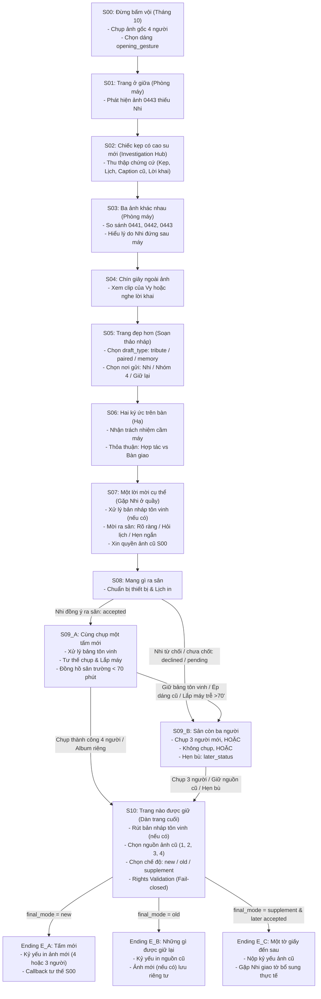

# Cây cốt truyện (Story Decision Tree) & Ma trận kiểm thử (Test Matrix) - CIVI MVP (v4.1)

Tài liệu này hệ thống hóa toàn bộ các nhánh rẽ, điều kiện kích hoạt, biến trạng thái và điểm nối giữa các cảnh dựa trên kịch bản `v4_1` (JSON Content tại `Game/Assets/_Civi/Content/Story/v4_1` và kịch bản `docs/story/kich-ban-mvp.md`). Đồng thời, tài liệu cung cấp **Ma trận kiểm thử (Test Matrix)** chuẩn hóa cho đội ngũ QA / TV5 kiểm thử tính đúng đắn khi prototype hoàn thiện.

---

## PHẦN 1: CÂY CỐT TRUYỆN TỔNG THỂ (HIGH-LEVEL STORY FLOW)

Sơ đồ Mermaid thể hiện luồng di chuyển giữa các Scene và các nhánh rẽ quyết định định hướng câu chuyện:

---

## PHẦN 2: CHI TIẾT TỪNG CẢNH VÀ CÁC LỰA CHỌN RẼ NHÁNH

### 1. Scene `S00` - Đừng bấm vội (Prologue)
*Bối cảnh: Buổi tập tháng 10. Chụp ảnh 4 người làm tư liệu gốc.*
- **Step `S00_MACHINE`**:
  - `S00_BOX`: Kê lại thùng và giữ điện thoại $\rightarrow$ `opening_support = "self"`. Nối tới $\rightarrow$ `S00_POSE`.
  - `S00_CLAMP`: Giữ chân kẹp cho Nhi $\rightarrow$ `opening_support = "clamp"`. Nối tới $\rightarrow$ `S00_POSE`.
  - `S00_ASK`: Nhờ Nhi kiểm kẹp, mình giữ dây $\rightarrow$ `opening_support = "ask"`. Nối tới $\rightarrow$ `S00_POSE`.
- **Step `S00_POSE`** *(Rất quan trọng - ảnh hưởng callback ở E_A)*:
  - `S00_POSE1`: Giơ tay tạo nét chữ HẸN $\rightarrow$ `opening_gesture = "pose_1"`. Nối tới $\rightarrow$ `S00_CAPTURE`.
  - `S00_POSE2`: Cùng nhìn sang một phía $\rightarrow$ `opening_gesture = "pose_2"`. Nối tới $\rightarrow$ `S00_CAPTURE`.
  - `S00_POSE3`: Đứng bình thường, trêu Minh $\rightarrow$ `opening_gesture = "pose_3"`. Nối tới $\rightarrow$ `S00_CAPTURE`.
- **Step `S00_CAPTURE`**:
  - `S00_SHOOT`: Đặt giờ và chụp $\rightarrow$ Thu thập `PHOTO_S00_GOOD`, `PHOTO_S00_BAD_01`, `PHOTO_S00_BAD_02`. Nối tới $\rightarrow$ `S00_ALBUM`.
- **Step `S00_ALBUM`**: Đặt tên album (`S00_ALBUM1`, `S00_ALBUM2`, `S00_ALBUM3`) $\rightarrow$ Nối tới `S00_DIAGRAM`.
- **Step `S00_DIAGRAM`**: `S00_KEEP`: Giữ sơ đồ tia chớp của Nhi (`PROP_DIAGRAM`) $\rightarrow$ Chuyển sang **Scene `S01`**.

---

### 2. Scene `S01` - Trang ở giữa & Scene `S02` - Chiếc kẹp có cao su mới (Điều tra)
*Bối cảnh: Tháng 5. Phòng máy trường. Nhìn thấy bản nháp 0443 thiếu Nhi.*
- `S01_OPEN` $\rightarrow$ `S01_COMPARE` $\rightarrow$ Chuyển sang **Scene `S02`**.
- **Step `S02_HUB`** (Dạng Hub khám phá tự do):
  - `S02_HELP`: Nhắn tin hỏi Nhi bài tập $\rightarrow$ Thu thập `PROP_SCHEDULE` (Nhi có mặt ở hội chợ lúc 16:15).
  - `S02_DIAGRAM`: Xem lại sơ đồ trang đôi của Nhi $\rightarrow$ `early_nhi_understanding = true`.
  - `S02_CLAMP`: Kiểm tra kẹp cao su $\rightarrow$ Thấy kẹp mới, vết hằn $\rightarrow$ Thu thập `PROP_CLAMP`.
  - `S02_CLOCK`: Xem đồng hồ mượn thiết bị $\rightarrow$ Thu thập `PROP_SCHEDULE`.
  - `S02_ASK_CAMERA`: Hỏi Vy ai cầm máy $\rightarrow$ `knows_handoff = true` (Vy xác nhận An đưa máy cho Nhi).
  - `S02_CAPTION`: Đọc câu caption cũ $\rightarrow$ Thu thập `PROP_CAPTION_OLD`.
  - `S02_LEAVE`: *Điều kiện: Đã xem đủ kẹp, lịch, caption* $\rightarrow$ Chuyển sang **Scene `S03`**.

---

### 3. Scene `S03` - Ba ảnh khác nhau & Scene `S04` - Chín giây ngoài ảnh
- **Step `S03_DESK`**: Xem ảnh 0441, 0442, 0443 và kẹp rỗng $\rightarrow$ `S03_WHY` $\rightarrow$ Khi đủ chứng cứ mở `S03_SOURCE` $\rightarrow$ Chuyển sang **Scene `S04`**.
- **Step `S04_SOURCE`**:
  - `S04_WATCH`: Xem 9 giây video do Vy quay $\rightarrow$ `saw_video = true`.
  - `S04_TESTIMONY`: *(Chỉ mở khi `knows_handoff = true`)*: Không cần xem clip, tin lời Vy $\rightarrow$ `saw_video = false`.
  - Nối tới `S04_AFTER` $\rightarrow$ `S04_DRAFT` $\rightarrow$ Chuyển sang **Scene `S05`**.

---

### 4. Scene `S05` - Trang đẹp hơn (Soạn thảo bản nháp)
*Quyết định bản nháp và nơi gửi - nguồn gốc rủi ro tâm lý.*
- **Step `S05_TEMPLATE`**:
  - `S05_TYPE_TRIBUTE`: Làm trang tôn vinh riêng Nhi $\rightarrow$ `draft_type = "tribute"`.
  - `S05_TYPE_PAIRED`: Làm trang ảnh đôi trước/sau theo ý Nhi $\rightarrow$ `draft_type = "paired"`.
  - `S05_TYPE_MEMORY`: Làm trang kỷ niệm 4 người $\rightarrow$ `draft_type = "memory"`.
- **Step `S05_RECIPIENT`**:
  - `S05_SEND_NHI`: Chỉ gửi Nhi xem trước $\rightarrow$ `draft_sent_to = "nhi"`, `draft_seen_by += ["NHI"]`.
  - `S05_SEND_GROUP_TRIBUTE`: *(Khi `draft_type == tribute`)*: Gửi nhóm 4 người $\rightarrow$ `draft_sent_to = "group_four"`, `draft_seen_by += ["NHI", "HA", "MINH"]`, `tribute_board_prepared = true` (Hạ chuẩn bị bảng tôn vinh!).
  - `S05_SEND_GROUP_OTHER`: *(Khi `draft_type != tribute`)*: Gửi nhóm 4 người $\rightarrow$ `draft_sent_to = "group_four"`.
  - `S05_HOLD`: Tạm giữ bản nháp $\rightarrow$ `draft_sent_to = "held"`.
  - Tất cả chuyển sang **Scene `S06`**.

---

### 5. Scene `S06` - Hai ký ức trên bàn (Đối thoại với Hạ)
- **Step `S06_TALK`**:
  - `S06_OWN`: An nhận lỗi việc đưa máy cho Nhi $\rightarrow$ `an_owned_camera_choice = "yes"`.
  - `S06_BLAME`: Đổ lỗi do hoàn cảnh $\rightarrow$ `an_owned_camera_choice = "deflected"`.
  - `S06_COMPARE`: So sánh thời điểm $\rightarrow$ `an_owned_camera_choice = "unresolved"`.
- **Step `S06_PLACE`**:
  - `S06_KEEP_AGREE` / `S06_PRIVATE_AGREE`: Hạ đồng ý hợp tác tiếp $\rightarrow$ `ha_support = "collaborate"`.
  - `S06_HANDOVER` / `S06_KEEP_HANDOVER`: Hạ chỉ bàn giao tư liệu rồi về ôn thi $\rightarrow$ `ha_support = "handover_only"`.
  - Tất cả chuyển sang **Scene `S07`**.

---

### 6. Scene `S07` - Một lời mời cụ thể (Gặp Nhi ở quầy hội chợ)
- **Step `S07_SHOW`**:
  - Nếu `draft_type == tribute`: Nhảy vào `S07_REACT` (xử lý phản ứng giận của Nhi).
  - Nếu `draft_type != tribute`: Nhảy thẳng vào `S07_INVITE`.
- **Step `S07_REACT`** *(Xử lý nháp tôn vinh)*:
  - `S07_STOP_SENT`: Nhận lỗi, hứa dừng bản gửi nhóm $\rightarrow$ `draft_retracted = "yes"`, `retraction_notified_to += ["NHI"]`.
  - `S07_STOP_PRIVATE`: Nhận lỗi, dừng bản nháp gửi riêng.
  - `S07_INSIST`: Cố giải thích khen Nhi $\rightarrow$ Gây áp lực: `invite_pressure = true`.
  - `S07_DISCUSS_AT_FIELD`: Hẹn ra sân nói chuyện tiếp $\rightarrow$ Chưa rút nháp.
- **Step `S07_INVITE`** *(Mời ra sân chụp ảnh mới lúc 16:45)*:
  - `S07_INVITE_CLEAR`: Mời rõ ràng, tôn trọng $\rightarrow$ `nhi_invite_status = "accepted"`.
  - `S07_ASK_AVAILABILITY`: Hỏi thăm lịch rảnh $\rightarrow$ Nhi bận/từ chối ra sân: `nhi_invite_status = "declined"`.
  - `S07_INVITE_SHORT`: Hẹn ngắn/chưa chốt $\rightarrow$ `nhi_invite_status = "pending"`.
  - `S07_ACCEPT_DECLINE`: *(Khi `invite_pressure == true`)*: Nhi chính thức từ chối $\rightarrow$ `nhi_invite_status = "declined"`.
- **Step `S07_OLD_RIGHTS`**: `S07_OLD_OK`: Nhi xác nhận đồng ý dùng nguồn ảnh cũ S00 $\rightarrow$ Chuyển sang **Scene `S08`**.

---

### 7. Scene `S08` - Mang gì ra sân (Chuẩn bị thiết bị & Lịch in)
- **Step `S08_ASSIGN`**: Phân công mang vác (`S08_ASSIGN` $\rightarrow$ `assigned`, `S08_ASSUME` $\rightarrow$ `assumed`).
- **Step `S08_PRINT`**:
  - `S08_NORMAL`: Giữ lịch in thường (10:00 sáng mai).
  - `S08_EXTEND`: Xin gia hạn in tới 12:00 $\rightarrow$ `print_slot = "extended"`, `extension_confirmed = true`.
- **Step `S08_CHECK`**:
  - `S08_READY`: Kiểm tra kẹp ngay $\rightarrow$ `equipment_ready = "ready"`, tốn 5 phút.
  - `S08_REPAIR_LATER`: Mang ra sân sửa $\rightarrow$ `equipment_ready = "repairable"`, tốn 5 phút.
- **Step `S08_ROUTE`**:
  - `S08_ARRIVE`: *(Điều kiện: `nhi_invite_status == accepted`)* $\rightarrow$ Chuyển sang **Scene `S09_A`**.
  - `S08_ABSENT`: *(Điều kiện: `nhi_invite_status != accepted`)* $\rightarrow$ Chuyển sang **Scene `S09_B`**.

---

### 8. Scene `S09_A` - Cùng chụp một tấm mới (Nhi có mặt ở sân)
*Quản lý thời gian: Nhi chỉ ở sân đến 17:10 (tương đương `courtyard_minute < 70`).*
- **Step `S09_A_BOARD`** *(Xử lý bảng tôn vinh)*:
  - `S09_A_REMOVE_BOARD`: Hạ và An tháo bảng $\rightarrow$ `tribute_board_removed = true` $\rightarrow$ `S09_A_FRAME`.
  - `S09_A_LEAVE_BOARD`: Để nguyên bảng $\rightarrow$ Nhi khó chịu bỏ về $\rightarrow$ `attendance = "left"`, chuyển sang `S09_A_LEAVE` $\rightarrow$ **Sang `S09_B`**!
  - `S09_A_NO_BOARD`: Không có bảng $\rightarrow$ `S09_A_FRAME`.
- **Step `S09_A_FRAME`**:
  - `S09_A_OPEN_FRAME`: Để mọi người tự nhiên $\rightarrow$ `S09_A_CAMERA`.
  - `S09_A_OLD_POSE`: Ép xếp lại đúng vị trí cũ $\rightarrow$ Nhi phản đối $\rightarrow$ `S09_A_REFUSE`:
    - `S09_A_CHANGE_FRAME`: Đổi lại chụp tự nhiên $\rightarrow$ `S09_A_CAMERA`.
    - `S09_A_STOP_FRAME`: Thôi không chụp $\rightarrow$ Nhi bỏ về $\rightarrow$ `attendance = "left"` $\rightarrow$ **Sang `S09_B`**!
- **Step `S09_A_CAMERA`**:
  - `S09_A_MOUNT`: Lắp máy ngay (khi `ready`, 0 phút) $\rightarrow$ `S09_A_CAPTURE`.
  - `S09_A_FIX`: Siết kẹp (khi `repairable`, tốn 4 phút) $\rightarrow$ `S09_A_CAPTURE`.
  - `S09_A_REBUILD`: Lắp lại toàn bộ chân máy $\rightarrow$ **Tốn 25 phút** $\rightarrow$ `courtyard_minute` vượt 70 $\rightarrow$ `S09_A_LEAVE` $\rightarrow$ **Sang `S09_B`**!
- **Step `S09_A_CAPTURE`**:
  - `S09_A_CAPTURE`: Chụp thành công 4 người $\rightarrow$ `captured_asset = "PHOTO_NEW_FOUR"`, `photo_result = "four"` $\rightarrow$ `S09_A_RIGHTS`.
  - `S09_A_TIMEOUT`: *(Hết giờ/Nhi đã về)* $\rightarrow$ Sang `S09_B`.
- **Step `S09_A_RIGHTS`**:
  - `S09_A_USE_PHOTO`: Nhi đồng ý in kỷ yếu $\rightarrow$ `nhi_photo_consent = "yes"`.
  - `S09_A_PRIVATE_ONLY`: Nhi chỉ cho giữ album riêng tư $\rightarrow$ `nhi_photo_consent = "no"`.
- `S09_A_PACK` $\rightarrow$ Chuyển sang **Scene `S10`**.

---

### 9. Scene `S09_B` - Sân còn ba người (An, Hạ, Minh)
- **Step `S09_B_DECIDE`**:
  - `S09_B_THREE`: Chụp 3 người $\rightarrow$ `S09_B_THREE`:
    - `S09_B_TAKE_THREE`: Chụp được ảnh 3 người $\rightarrow$ `captured_asset = "PHOTO_NEW_THREE"`, `photo_result = "three"`.
      - Quyền: `S09_B_THREE_PRINT` (cho in) vs `S09_B_THREE_PRIVATE` (chỉ album riêng).
    - `S09_B_TOO_LATE`: Quá 17:30 $\rightarrow$ Không chụp kịp $\rightarrow$ `photo_result = "none"`.
  - `S09_B_NO_PHOTO`: Không chụp mới, giữ trang cũ $\rightarrow$ `photo_result = "none"`.
  - `S09_B_LATER`: Đề nghị hẹn Nhi một buổi bù sau:
    - `S09_B_LATER_CLEAR`: *(Không có áp lực cũ)*: Nhi đồng ý hẹn ngày cụ thể $\rightarrow$ `later_status = "accepted"`.
    - `S09_B_LATER_PENDING`: Hẹn chung chung chưa chốt $\rightarrow$ `later_status = "pending"`.
    - `S09_B_LATER_REFUSED`: *(Bị áp lực cũ)*: Nhi từ chối $\rightarrow$ `later_status = "declined"`.
- `S09_B_PACK` $\rightarrow$ Thu dọn đồ $\rightarrow$ Chuyển sang **Scene `S10`**.

---

### 10. Scene `S10` - Trang nào được giữ (Chốt dữ liệu xuất bản)
- **Step `S10_WORK`**: Làm cùng Hạ (`S10_WITH_HA`) hoặc làm một mình (`S10_ALONE`).
- **Step `S10_NOTICE`**:
  - Thu hồi bản nháp tôn vinh và gửi thông báo cho Hạ, Minh (nếu trước đó đã gửi nhóm).
- **Step `S10_OLD`**: Chọn tư liệu gốc cũ:
  - `S10_OLD_1`: Ảnh S00 tốt (`PHOTO_S00_GOOD`).
  - `S10_OLD_2`: Ảnh S00 hỏng 1 (`PHOTO_S00_BAD_01`).
  - `S10_OLD_3`: Ảnh S00 hỏng 2 (`PHOTO_S00_BAD_02`).
  - `S10_OLD_4`: Sơ đồ của Nhi (`PROP_DIAGRAM`).
- **Step `S10_NEW`**: Chọn chế độ nộp trang kỷ yếu:
  - `S10_NEW_FOUR`: *(Khi có ảnh 4 và Nhi đồng ý in)* $\rightarrow$ `final_mode = "new"`.
  - `S10_NEW_THREE`: *(Khi có ảnh 3 và được in)* $\rightarrow$ `final_mode = "new"`.
  - `S10_ONLY_OLD`: Giữ nguồn cũ $\rightarrow$ `final_mode = "old"`.
  - `S10_SUPPLEMENT`: *(Khi `later_status == accepted`)* $\rightarrow$ `final_mode = "supplement"`.
- **Step `S10_0443`**: Giữ ảnh 0443 riêng hay đưa vào kèm chú thích tôn trọng sự thật.
- **Step `S10_RIGHTS` & `S10_PREVIEW`**: Xem trước và chạy kiểm quyền toàn bộ nhân vật.
- **Step `S10_PUBLISH`**:
  - `S10_PUBLISH_NEW` $\rightarrow$ Chuyển sang **Ending `E_A`**.
  - `S10_PUBLISH_OLD` $\rightarrow$ Chuyển sang **Ending `E_B`**.
  - `S10_PUBLISH_SUPPLEMENT` $\rightarrow$ Chuyển sang **Ending `E_C`**.

---

### 11. Các Nhánh Kết (Endings)
1. **Ending `E_A` - Tấm mới**:
   - Xuất bản kỷ yếu với ảnh mới (4 người hoặc 3 người).
   - Đoạn hội thoại kết có **Callback** khớp chính xác với tư thế `opening_gesture` người chơi đã chọn tại `S00` (pose_1 / pose_2 / pose_3).
2. **Ending `E_B` - Những gì được giữ lại**:
   - Xuất bản kỷ yếu với ảnh cũ S00 đã được mọi người đồng thuận.
   - Nếu có chụp ảnh mới ở sân (ảnh 4 hoặc ảnh 3) nhưng chọn không in kỷ yếu, ảnh vẫn được lưu giữ trân trọng trong album riêng tư của nhóm.
3. **Ending `E_C` - Một tờ giấy đến sau**:
   - Kỷ yếu chính nộp nguồn cũ.
   - Đến ngày hẹn, An và Nhi gặp nhau thực tế, bàn giao tờ phụ lục bổ sung.
   - Người chơi có thể chọn chụp thêm một tấm ảnh mới tại buổi gặp (`E_C_ASK_NEW`), xin quyền in phụ lục hoặc giữ riêng tư, hoàn tất việc trao gửi.

---

## PHẦN 3: MA TRẬN KIỂM THỬ PROTOTYPE (TEST MATRIX)

Ma trận này gồm **22 ca kiểm thử đường đi chuẩn (Route Cases)** và **5 ca kiểm thử chặn vi phạm (Negative / Fail-closed Invariant Cases)** được trích xuất từ bộ validation logic của TV1. Khi có bản prototype Unity, QA/TV5 chỉ cần kiểm thử theo các kịch bản sau:

### 1. Ma trận 22 Kịch bản Đường Đi (Route Scenarios)

| Mã Case | Tên Kịch Bản | Lựa Chọn Mấu Chốt (Overrides) | Kết Thúc (Ending) | Kết Quả Ảnh (Photo) | Điều Kiện Bất Biến Cần Xác Minh (Key Assertions) |
| :--- | :--- | :--- | :---: | :---: | :--- |
| **TC-01** | `four` (Đường chuẩn đủ 4) | Mặc định (Tự nhiên, mời rõ ràng, tháo bảng nếu có) | `E_A` | `four` | Đủ consent grant in kỷ yếu của cả 4 người; có callback tư thế S00. |
| **TC-02** | `early_understanding` | `S02_DIAGRAM` $\rightarrow$ `S05_TYPE_PAIRED` $\rightarrow$ `S04_TESTIMONY` | `E_A` | `four` | Không xem clip Vy (`saw_video=false`), không làm bảng tôn vinh. |
| **TC-03** | `ha_handover` | `S06_BLAME` $\rightarrow$ `S06_HANDOVER` | `E_A` | `four` | `ha_support=handover_only`; S10 An làm một mình (`S10_ALONE`). |
| **TC-04** | `declined_three` | `S07_INVITE: S07_ASK_AVAILABILITY` | `E_A` | `three` | Nhi từ chối ra sân $\rightarrow$ sang S09_B chụp 3 người và in kỷ yếu. |
| **TC-05** | `pending_three` | `S07_INVITE: S07_INVITE_SHORT` | `E_A` | `three` | Lời mời chưa chốt $\rightarrow$ Nhi vắng $\rightarrow$ sang S09_B chụp 3 và in. |
| **TC-06** | `no_new` | `S07_ASK_AVAILABILITY` $\rightarrow$ `S09_B_NO_PHOTO` | `E_B` | `none` | Không chụp mới $\rightarrow$ S10 chỉ dùng nguồn cũ S00. |
| **TC-07** | `three_private` | `S07_INVITE_SHORT` $\rightarrow$ `S09_B_THREE_PRIVATE` | `E_B` | `three` | Chụp 3 người nhưng chỉ lưu riêng tư $\rightarrow$ kỷ yếu in nguồn cũ. |
| **TC-08** | `four_not_printed` | `S09_A_RIGHTS: S09_A_PRIVATE_ONLY` | `E_B` | `four` | Chụp 4 người nhưng Nhi không cho in kỷ yếu $\rightarrow$ in nguồn cũ, lưu ảnh riêng. |
| **TC-09** | `leave_early` | `S09_A_CAMERA: S09_A_REBUILD` | `E_A` | `three` | Lắp máy tốn 25' $\rightarrow$ quá 17:10 Nhi về $\rightarrow$ chuyển S09_B chụp 3. |
| **TC-10** | `forced_pose_changed` | `S09_A_OLD_POSE` $\rightarrow$ `S09_A_CHANGE_FRAME` | `E_A` | `four` | Ép dáng cũ $\rightarrow$ Nhi phản ứng $\rightarrow$ đổi dáng tự nhiên $\rightarrow$ chụp đủ 4. |
| **TC-11** | `forced_pose_stopped` | `S09_A_OLD_POSE` $\rightarrow$ `S09_A_STOP_FRAME` | `E_A` | `three` | Ép dáng cũ $\rightarrow$ dừng chụp $\rightarrow$ Nhi về $\rightarrow$ S09_B chụp 3 người. |
| **TC-12** | `tribute_retracted` | `S05_TYPE_TRIBUTE` $\rightarrow$ Gửi nhóm $\rightarrow$ `S09_A_REMOVE_BOARD` | `E_A` | `four` | Thu hồi nháp, tháo bảng tôn vinh thành công $\rightarrow$ Nhi ở lại chụp 4. |
| **TC-13** | `tribute_board_kept` | `S05_TYPE_TRIBUTE` $\rightarrow$ Gửi nhóm $\rightarrow$ `S09_A_LEAVE_BOARD` | `E_A` | `three` | Không tháo bảng tôn vinh $\rightarrow$ Nhi bỏ về $\rightarrow$ S09_B chụp 3 người. |
| **TC-14** | `pressure_absence` | `S05_TYPE_TRIBUTE` $\rightarrow$ `S07_INSIST` | `E_A` | `three` | Ép nhận nháp $\rightarrow$ tạo áp lực $\rightarrow$ Nhi từ chối ra sân $\rightarrow$ S09_B chụp 3. |
| **TC-15** | `later_old` | `S09_B_LATER_CLEAR` $\rightarrow$ `S10_SUPPLEMENT` $\rightarrow$ `E_C_HAND_OLD` | `E_C` | `none` | Hẹn bù thành công $\rightarrow$ giao tờ phụ lục bổ sung dùng nguồn cũ. |
| **TC-16** | `later_new` | `S09_B_LATER_CLEAR` $\rightarrow$ `S10_SUPPLEMENT` $\rightarrow$ `E_C_ASK_NEW` | `E_C` | `later` | Hẹn bù $\rightarrow$ gặp Nhi chụp thêm ảnh mới và đồng ý in tờ phụ lục. |
| **TC-17** | `later_new_private` | TC-16 nhưng chọn `E_C_LATER_PRIVATE` | `E_C` | `later` | Ảnh chụp bù chỉ lưu riêng tư $\rightarrow$ tờ bổ sung dùng tư liệu hợp lệ khác. |
| **TC-18** | `later_pending` | `S09_B_LATER: S09_B_LATER_PENDING` | `E_B` | `none` | Hẹn bù chưa được chấp thuận $\rightarrow$ không được vào E_C, phải kết E_B. |
| **TC-19** | `old_bad_01` | `S10_OLD: S10_OLD_2` | `E_A` | `four` | Dùng ảnh hỏng 1 (Minh cúi nhặt bìa) làm nền kỷ yếu kèm ảnh mới 4 người. |
| **TC-20** | `old_bad_02` | `S10_OLD: S10_OLD_3` | `E_A` | `four` | Dùng ảnh hỏng 2 (đèn tắt) làm nền kỷ yếu kèm ảnh mới 4 người. |
| **TC-21** | `old_diagram` | `S10_OLD: S10_OLD_4` | `E_A` | `four` | Dùng sơ đồ ý tưởng của Nhi làm nền kỷ yếu kèm ảnh mới 4 người. |
| **TC-22** | `extended` | `S08_PRINT: S08_EXTEND` | `E_A` | `four` | Chọn xin gia hạn in tới 12:00 trưa hôm sau $\rightarrow$ `extension_confirmed=true`. |

---

### 2. Ma trận 5 Ca Kiểm Thử Chặn Vi Phạm (Negative / Fail-Closed Checks)

Đảm bảo prototype tuân thủ nguyên tắc **Fail-Closed** và **Bảo vệ quyền nội dung (Consent & State Boundaries)**:

| Mã Case | Tình Huống Giả Định | Thao Tác Thử Nghiệm | Kỳ Vọng Hệ Thống (Expected Enforcement) |
| :--- | :--- | :--- | :--- |
| **NEG-01** | Nhi vắng mặt (`attendance == absent`) | Cố gắng gọi hoặc kích hoạt lựa chọn chụp 4 người `S09_A_CAPTURE` | **BỊ CHẶN / ẨN**: Không thể chụp ảnh có Nhi khi Nhi vắng. |
| **NEG-02** | Nhi đã về (`attendance == left`) | Cố gắng gọi hoặc kích hoạt lựa chọn chụp 4 người `S09_A_CAPTURE` | **BỊ CHẶN / ẨN**: Quá giờ (sau 17:10) hoặc Nhi đã bỏ về, máy không thể chụp ảnh 4 người. |
| **NEG-03** | Thiếu quyền của Nhi (`NHI grant == missing`) | Xuất bản kỷ yếu ở S10 khi chưa có sự đồng ý của Nhi cho nguồn ảnh | **BỊ CHẶN NỘP IN**: Hệ thống báo lỗi thiếu quyền tác giả/hình ảnh của Nhi. |
| **NEG-04** | Thiếu quyền của Hạ (`HA grant == missing`) | Xuất bản kỷ yếu ở S10 khi thiếu sự đồng ý của Hạ cho ảnh cũ | **BỊ CHẶN NỘP IN**: Không cho nộp in nếu Hạ chưa đồng thuận nguồn ảnh. |
| **NEG-05** | Thiếu quyền của Minh (`MINH grant == missing`) | Xuất bản kỷ yếu ở S10 khi thiếu sự đồng ý của Minh cho ảnh cũ | **BỊ CHẶN NỘP IN**: Không cho nộp in nếu Minh chưa đồng thuận nguồn ảnh. |
| **NEG-06** | Chưa tháo bảng tôn vinh mà rút nháp | Đã làm bảng tôn vinh, rút nháp nhưng không gỡ bảng ở S09_A | **BỊ CHẶN HOẶC ÉP RẼ**: Nhi nhìn thấy bảng sẽ lập tức bỏ về (`attendance = left`). |
| **NEG-07** | Nhảy vào `E_C` khi hẹn chưa chốt | `later_status == pending` hoặc `declined` mà cố chọn nộp tờ bổ sung `S10_SUPPLEMENT` | **BỊ KHÓA LỰA CHỌN**: Chỉ `accepted` mới mở được nhánh phụ lục `E_C`. |
